# Cleanup Plan — Ayez Ahlaq (عايز أحلق)

> Generated 2026-10-18 from a read-only audit of `lib/` (~1,814 hand-written Dart files, 172 screens, 96 cubits, 66 API classes, 294 use cases). **No source file was changed.** Tick items as they are fixed.
>
> **How to read the tags** — `[Rule A]` unnecessary / duplicated API calls · `[Rule B]` mutation loader / double-submit / error handling · `[Rule C]` stale data between list ↔ details and across accounts · `[Rule D]` general cleanup. Priority: **High** (user-visible bug, data leak, or wasteful on every launch) · **Medium** · **Low**.
>
> **Verification levels** — items without a marker were confirmed either by reading the code at the quoted `file:line` or by an exact mechanical check (import graph, call graph, diff). Items marked *(needs confirmation)* are inferred from structure/automated scans and should be checked first (e.g. in Chucker or with a quick test). Screens are labelled `verified: read` (screen + its cubit were read line by line) or `verified: scanned` (automated checks only: open-time calls, mutation → loader/busy-state mapping, dispose/hardcoded-string/size scans, duplicate-load detection). "No issues found" on a *scanned* screen means the automated checks were clean, not that it was proofread.

## 1. Types & Relations

One Flutter app, three roles (`customer`, `barber`, `merchant`, `lib/shared/user_type.dart`). Data flow is `Screen → Cubit → UseCase → IRepo → Repo → Api → NetworkService` (`Either<Failure, T>`). **State holders are Cubits; 79 of them are created once in `lib/core/routes/app_routes.dart:292-402` (`sl<X>()`, provided with `BlocProvider.value`, never closed) and only ~16 are screen-scoped (`BlocProvider(create: …)`).** There is no HTTP response cache layer: "cache" = whatever the singleton cubit still holds. Auth token → `SecureStorage`; user type, language, theme, must-change-password flag → `PreferencesStorage`; barber shop photo → `BarberProfileImageCache` (disk).

### 1.1 Main types (37)

Paths are relative to `lib/features/`. `{role}` = `customer` / `barber` / `merchant` (same endpoint family under each prefix). *Holder* = the cubit that stores it.

| # | Type (entities) | Defined in | Endpoints (verb path) | Holder / cache |
|---|---|---|---|---|
| 1 | **UserType** | `shared/user_type.dart` (outside features) | — | `PreferencesStorage` (`userType`), `UserHelpers` |
| 2 | **AuthSession** (token, tickets) | `core/session/session_manager.dart`, `core/cache/secure_storage/` | POST `{role}/login`, `{role}/register`, `register/verifyOtp`, `register/resendOtp`, `password/forgot`, `password/verifyOtp`, `password/reset` | `SecureStorage` token; `CustomerAuthCubit`/`BarberAuthCubit`/`MerchantAuthCubit` (singletons) |
| 3 | **CustomerProfile** | `customer/profile/domain/entities/customer_profile.dart` | GET `customer`; PUT `customer/password`; DELETE `customer` | `CustomerProfileCubit` (singleton) |
| 4 | **BarberProfile** (+`BarberPermissions`, `BarberAccountKind`) | `barber/profile/domain/entities/barber_profile.dart` | GET `barber`; PUT `barber/location`, `barber/servesClients`, `barber/password`; DELETE `barber`; GET/UPLOAD/DELETE `barber/profileImage` | `BarberProfileCubit` (singleton) + `BarberProfileImageCache` (disk) |
| 5 | **MerchantProfile** (+`MerchantPhone`) | `merchant/profile/domain/entities/merchant_profile.dart`, `merchant_phone.dart` | GET/PUT `merchant/profile`; PUT `merchant/location`, `merchant/password`; DELETE `merchant`; GET/POST/DELETE `merchant/phone` | `MerchantProfileCubit`, `MerchantPhonesCubit` |
| 6 | **Document** (`BarberDocument`, `MerchantDocument`) | `barber/documents/…/barber_document.dart`, `merchant/documents/…/merchant_document.dart` | GET `{barber\|merchant}/attachment`; GET/UPLOAD/DELETE `…/attachment/:id/file` | `BarberDocumentsCubit`, `MerchantDocumentsCubit` |
| 7 | **Shop** (+`ShopDetail`, `ShopBarber`, `ShopBarberService`, `ShopAddon`, `ShopDrink`, `HaircutStyle`) | `customer/shops/domain/entities/` | GET `customer/shop`; GET `customer/shop/:id` | `CustomerShopsCubit` (list), `CustomerShopDetailCubit` (detail, stale-response guard) |
| 8 | **BarberService** (+`OwnService`, `ServiceCatalogItem`) | `barber/services/domain/entities/` | GET/POST/PUT/DELETE `barber/service[/:id]`, `barber/service/own[/:id]`; GET `barber/service/catalog` | `BarberServicesCubit`, `OwnServicesCubit` |
| 9 | **ShopHaircutStyle** | `barber/services/domain/entities/shop_haircut_style.dart` | GET `barber/haircutStyle`; PUT `barber/haircutStyle/:id` | `ShopHaircutStylesCubit` |
| 10 | **WorkingDay** | `barber/hours/domain/entities/` | GET/PUT `barber/hours`, `barber/homeService/hours`, `barber/team/:id/hours` | `BarberHoursCubit`, `HomeServiceHoursCubit`, `MemberHoursCubit` |
| 11 | **Drink** | `barber/drinks/domain/entities/` | GET/POST/PUT/DELETE `barber/drink[/:id]` | `BarberDrinksCubit` |
| 12 | **TeamMember** (+`TeamMemberDetail`, `MemberClient`, `Earnings`, `DailyEarning`) | `barber/team/domain/entities/` | GET/POST `barber/team`; GET/PUT/DELETE `barber/team/:id`; PUT `…/availability`, `…/activate`, `…/permissions`; DELETE `…/permanent`; GET `…/earnings`, `…/clients`, `…/service[/catalog]`; GET `barber/earnings` | `BarberTeamCubit`, `TeamMemberDetailCubit`, `Member{Hours,Services,Earnings,Clients}Cubit`, `EarningsCubit` (all singletons) |
| 13 | **Invite** (`BarberInvite`, `BarberInvitePreview`) | `barber/invite/…`, `customer/favorites/domain/entities/` | GET `barber/invite`; PUT `barber/invite/regenerate`; GET `invite/:code`; POST `customer/favorite/invite/:code` | `BarberInviteCubit`, `InvitePreviewCubit` |
| 14 | **FavoriteBarber** | `customer/favorites/domain/entities/` | GET `customer/favorite`; POST/DELETE `customer/favorite/:barberId` | `FavoritesCubit`; toggled from `CustomerShopDetailCubit` |
| 15 | **Rating** (`CustomerRating`, `PendingVisitRating`, `PendingMerchantRating`, `BarberReview`) | `customer/ratings/…`, `barber/ratings/…`, `barber/reviews/…` | POST `customer/rating[/visit\|/order]`; GET `customer/rating[/pending]`; GET `barber/review`, `barber/rating/pending`; POST `barber/rating/merchant` | `CustomerRatingsCubit`, `Pending*RatingCubit`, `BarberReviewsCubit` |
| 16 | **CustomerBooking** (+`BookingAddon`, `BookingDrink`, `BookingSlots`, `BookingSlotBarber`) | `customer/booking/domain/entities/` | GET `customer/booking/slots`; POST/GET `customer/booking`; GET `customer/booking/:id`; PUT `…/cancel` | `BookingFlowCubit` (draft), `MyBookingsCubit` (list), `BookingDetailCubit` (detail) |
| 17 | **Booking** (barber side; +`BookingAdjustment`, `WalkInOption`, `BookingSettleItem`) | `barber/bookings/domain/entities/` | GET `barber/booking`, `…/pending`, `…/queue`, `…/unresolved`, `…/:id`; PUT `…/:id/confirm\|reject\|status\|billing`; POST `…/walkin`; GET `…/walkin/options`; settle | `BookingsCubit` (pending/queue/history slices), `UnresolvedBookingsCubit`, `WalkInOptionsCubit` |
| 18 | **HomeServiceRequest** (customer; +`HomeServiceShop`, `HomeServiceAdjustment`) | `customer/home_service/domain/entities/` | GET `customer/homeService/shop`; POST/GET `customer/homeService`; GET `…/:id`; PUT `…/:id/confirmPrice\|cancel\|retry` | `HomeServiceShopsCubit`, `HomeServiceRequestFormCubit`, `HomeServiceRequestsCubit`, `HomeServiceRequestDetailCubit` |
| 19 | **HomeServiceRequest** (barber) / **HomeServiceBroadcast** / **HomeServiceSettings** | `barber/home_service_requests`, `home_service_broadcast`, `home_service` | GET `barber/homeService/request[/:id]`; PUT `…/price\|accept\|reject\|status`; GET/PUT `barber/homeService/broadcast…`; GET/PUT `barber/homeService`, `…/hours` | `HomeServiceRequestsCubit`, `HomeServiceBroadcastCubit`, `HomeServiceSettingsCubit`, `HomeServiceHoursCubit` |
| 20 | **MerchantProduct** (+`ActiveDiscount`) | `merchant/products/domain/entities/` | GET/UPLOAD `merchant/product`; PUT/DELETE `…/:id`; PUT `…/:id/stock`; DELETE `…/:id/image/:imageId` | `MerchantProductsCubit` |
| 21 | **MerchantCategory** | `merchant/categories/domain/entities/` | GET/UPLOAD `merchant/category`; GET `…/own`; PUT/DELETE `…/:id` | `MerchantCategoriesCubit` |
| 22 | **PurchaseOrder** (+`OrderItem`) | `merchant/orders/domain/entities/` | GET `merchant/order[/:id]`; PUT `…/:id/accept\|reject\|status` | `MerchantOrdersCubit` |
| 23 | **Discount** (+`AppliedDiscount`, `DiscountQuote`, `QuoteLine`, `DiscountShop`; `BarberDiscount`) | `merchant/discounts/…`, `barber/discounts/…` | CRUD `merchant/discount`; PUT `…/:id/close`; POST `…/quote`; GET `…/shop`; CRUD `barber/discount` | `MerchantDiscountsCubit`, `DiscountQuoteCubit`, `BarberDiscountsCubit` |
| 24 | **MerchantCustomer / MerchantDashboard / DeliverySettings** | `merchant/customers`, `dashboard`, `delivery` | GET `merchant/customer`; GET `merchant/dashboard`; GET/PUT `merchant/delivery` | `MerchantCustomersCubit`, `MerchantDashboardCubit`, `MerchantDeliveryCubit` |
| 25 | **Storefront** (barber shop sells: `StorefrontProduct`, `StorefrontCategory`, `StorefrontOrder`, `StorefrontDeliverySettings`) | `barber/storefront/**/domain/entities/` | CRUD `barber/storefront/product\|category`; GET/PUT `…/delivery`; GET `…/order[/:id]`; PUT `…/order/:id/accept\|reject\|status` | `BarberStorefront{Products,Categories,Delivery,Orders}Cubit` |
| 26 | **BarberStore** (barber buys from merchants: `StoreMerchant`, `StoreProduct`, `StoreFeedProduct`, `Cart`/`CartLine`, `StoreQuote`, `StoreOrder`) | `barber/store/domain/entities/` | GET `barber/store/merchant[/:id/product]`, `…/product`, `…/category`; GET/PUT `barber/cart`; POST `barber/store/quote`, `barber/cart/checkout`; GET `barber/order[/:id]`; PUT `…/cancel` | `BarberStoreMerchantsCubit`, `BarberStoreFeedCubit`, `BarberStoreCartCubit`, `BarberStoreOrdersCubit` |
| 27 | **CustomerStore** (`ShopStorefront`, `StoreProduct`, `StoreCategory`, `StoreCart`/`StoreCartLine`, `StoreOrder`, `StoreDelivery`) | `customer/store/domain/entities/` | GET `customer/shop/:id/storefront`; GET/PUT `customer/cart`; POST `customer/cart/checkout`; GET `customer/order[/:id]`; PUT `…/cancel` | `CustomerStoreFeedCubit`, `StoreCartCubit`, `StoreOrdersCubit` |
| 28 | **Wallet** (+`WalletTransaction`) ×3 | `{role}/wallet/domain/entities/` | GET `{role}/wallet` | `CustomerWalletCubit`, `BarberWalletCubit`, `MerchantWalletCubit` |
| 29 | **WalletRequest** (+`WalletRequestPage`, `TransferAccount`, `WithdrawMethod`) ×3 | `{role}/wallet/domain/entities/` | GET/UPLOAD `{role}/walletRequests`; GET `…/:id` (merchant); PUT `…/:id/cancel`; GET `{role}/transferAccount[/withdrawMethods]` | `*WalletRequestsCubit`, `CreateWalletRequestCubit` (screen-scoped) |
| 30 | **Money** (`MoneyItem`, `MoneyEntry`, `MoneyOccurrence`, `MoneySummary`, `MoneyPin`) | `barber/money/domain/entities/` | CRUD `barber/money/item`; GET/POST `…/entry`; GET `…/summary`; GET/PUT `…/occurrence/pending\|:id/confirm\|:id/dismiss`; GET/POST/PUT `barber/moneyPin`, `…/verify`, `…/resetRequest` | `MoneyHome/Items/EntriesCubit` (screen-scoped), `MoneyPinCubit` (singleton) |
| 31 | **Notification** (+`NotificationPage`, `NotificationKind`) ×3 | `{role}/notifications/domain/entities/` | GET `{role}/notification[/unseenCount]`; PUT `…/seen`, `…/:id/seen`, `…/:id/clicked` | `*NotificationsCubit` (unseen count lives here) |
| 32 | **DeviceToken** | `{role}/device_token/…` (services only) | POST/DELETE `{role}/deviceToken[/all]` | `*DeviceTokenSyncService` (no cubit) |
| 33 | **Broadcast** (+`BroadcastPage`, `BroadcastScope`) | `barber/broadcast`, `merchant/broadcast` | GET/POST `{barber\|merchant}/broadcast` | `BarberBroadcastCubit`, `BroadcastListCubit`, `Merchant*` |
| 34 | **Subscription** (+`SubscriptionPlan`, `SubscriptionQuota`, `SubscriptionRequest`, `SubscribeResult`) ×2 | `barber/subscription`, `merchant/subscription` | GET `{barber\|merchant}/subscription[/plan\|/request]`; POST `…/subscribe` | `*SubscriptionCubit`, `*SubscriptionRequestsCubit` |
| 35 | **Sponsorship** ×2 | `barber/sponsorship`, `merchant/sponsorship` | GET/POST `{barber\|merchant}/sponsorship` | `*SponsorshipCubit` |
| 36 | **PaymentMethod** | `customer/payment_methods`, `barber/payment_methods` | GET `{customer\|barber}/paymentMethod` | `PaymentMethodsCubit`, `BarberPaymentMethodsCubit` |
| 37 | **SupportInfo** | `shared/support/` | GET `support` | `SupportCubit` (app-level, loaded at launch) |

### 1.2 Relations

```mermaid
erDiagram
  USER_TYPE ||--o{ AUTH_SESSION : "selects"
  AUTH_SESSION ||--|| PROFILE : "owns (customer|barber|merchant)"
  PROFILE ||--o{ DOCUMENT : "uploads"
  PROFILE ||--o{ DEVICE_TOKEN : "registers"
  PROFILE ||--o{ NOTIFICATION : "receives"
  PROFILE ||--|| WALLET : "has"
  WALLET ||--o{ WALLET_TRANSACTION : "contains"
  WALLET ||--o{ WALLET_REQUEST : "creates"
  WALLET_REQUEST }o--|| TRANSFER_ACCOUNT : "pays to"
  WALLET_REQUEST }o--o| WITHDRAW_METHOD : "uses"
  BARBER_PROFILE ||--o{ TEAM_MEMBER : "employs"
  BARBER_PROFILE ||--o{ BARBER_SERVICE : "offers"
  BARBER_PROFILE ||--o{ SHOP_HAIRCUT_STYLE : "prices"
  BARBER_PROFILE ||--o{ WORKING_DAY : "opens"
  BARBER_PROFILE ||--o{ DRINK : "sells"
  BARBER_PROFILE ||--o| INVITE : "shares"
  BARBER_PROFILE ||--|| SUBSCRIPTION : "pays"
  SUBSCRIPTION }o--|| SUBSCRIPTION_PLAN : "is"
  SUBSCRIPTION ||--o{ SUBSCRIPTION_QUOTA : "limits"
  SHOP ||--o{ SHOP_BARBER : "lists"
  SHOP ||--o{ BARBER_SERVICE : "catalog"
  CUSTOMER_PROFILE ||--o{ FAVORITE_BARBER : "stars"
  FAVORITE_BARBER }o--|| SHOP_BARBER : "points to"
  CUSTOMER_PROFILE ||--o{ CUSTOMER_BOOKING : "books"
  CUSTOMER_BOOKING }o--|| SHOP : "at"
  CUSTOMER_BOOKING }o--o| SHOP_BARBER : "with"
  CUSTOMER_BOOKING }o--|| BARBER_SERVICE : "for (serviceTypeId)"
  CUSTOMER_BOOKING }o--o| SHOP_HAIRCUT_STYLE : "style"
  CUSTOMER_BOOKING ||--o{ BOOKING_ADDON : "adds"
  CUSTOMER_BOOKING ||--o{ BOOKING_DRINK : "adds"
  CUSTOMER_BOOKING ||--o{ RATING : "rated by"
  CUSTOMER_BOOKING ||--|| BARBER_BOOKING : "same row, barber view"
  BARBER_BOOKING ||--o{ BOOKING_ADJUSTMENT : "billing"
  CUSTOMER_PROFILE ||--o{ HOME_SERVICE_REQUEST : "requests"
  HOME_SERVICE_REQUEST ||--o{ HOME_SERVICE_BROADCAST : "offered to barbers"
  HOME_SERVICE_REQUEST ||--o{ RATING : "rated by"
  SHOP ||--o{ STOREFRONT_PRODUCT : "sells"
  STOREFRONT_PRODUCT }o--o| STOREFRONT_CATEGORY : "in"
  CUSTOMER_PROFILE ||--o| STORE_CART : "fills"
  STORE_CART ||--o{ STORE_CART_LINE : "lines"
  STORE_CART_LINE }o--|| STOREFRONT_PRODUCT : "product"
  STORE_CART ||--o| STORE_ORDER : "checkout"
  STORE_ORDER ||--o{ STORE_ORDER_ITEM : "items"
  MERCHANT_PROFILE ||--o{ MERCHANT_PRODUCT : "sells"
  MERCHANT_PRODUCT }o--o| MERCHANT_CATEGORY : "in"
  MERCHANT_PRODUCT ||--o{ DISCOUNT : "discounted by"
  BARBER_PROFILE ||--o| BARBER_CART : "fills"
  BARBER_CART ||--o{ MERCHANT_PRODUCT : "buys"
  BARBER_CART ||--o| PURCHASE_ORDER : "checkout"
  MERCHANT_PROFILE ||--o{ PURCHASE_ORDER : "fulfils"
  PURCHASE_ORDER ||--o{ ORDER_ITEM : "items"
  NOTIFICATION }o--o| ANY_ENTITY : "referenceType + referenceId"
```

| Relation | Kind | Where it shows up | Risk |
|---|---|---|---|
| Shop → ShopBarber → BarberService | 1 → many → many | `ShopDetail` aggregate returned by one `GET customer/shop/:id` | detail replaced as a whole; favourite toggle mutates it locally (stale vs `FavoritesCubit`) |
| CustomerBooking ↔ barber `Booking` | same backend row, two models | `customer/booking/**` vs `barber/bookings/**` | duplicated entities/addons/drinks (B-1) |
| Booking → Addon / Drink / Adjustment | 1 → many | booking flow draft (`BookingFlowState`) → submit payload; barber bill editor | `BookingFlowCubit` draft is reset by `startFlow` (good) |
| Rating → Booking / HomeServiceRequest / StoreOrder | many → 1 (polymorphic `targetId`) | rate sheets post `customer/rating` | detail cubits do not refresh the lists (C items) |
| Notification → any entity | polymorphic `referenceType/referenceId` | `*NotificationTapRouter` opens detail screens | routes taking an entity in `extra` cannot be restored from an id (G-17) |
| Cart → CartLine → Product | 1 → many → 1 | `PUT {customer\|barber}/cart` replaces the **whole** cart each time | concurrent edits lose updates (screen items) |
| Wallet → WalletRequest → TransferAccount / WithdrawMethod | 1 → many → 1 | create-request screens load accounts + methods every open | triple-implemented (W-1) |
| Subscription → Plan / Quota | many → 1, 1 → many | home card + subscription screen | plans fetched with the subscription on every load |
| Profile → Document / Notification / DeviceToken | 1 → many | shells preload documents + unseen count; blocking gates on missing docs | duplicate per role (G-9) |

### 1.3 List → Details map (Rule C overview)

| List (state holder) | Details | Data hand-off | Reset on open | Stale-response guard | List kept in sync after mutation |
|---|---|---|---|---|---|
| `MyBookingsCubit` | customer `BookingDetailScreen` | id | yes (`loadBooking`) | **yes** | **no** (cancel/rate) |
| `HomeServiceRequestsCubit` (customer) | `HomeServiceRequestDetailScreen` | id | yes | **yes** | **no** |
| `CustomerShopsCubit` | `CustomerShopDetailScreen` | id | yes | **yes** | n/a (favourite toggle does not reach `FavoritesCubit`) |
| `StoreOrdersCubit` / `BarberStoreOrdersCubit` / `MerchantOrdersCubit` / `BarberStorefrontOrdersCubit` | order detail screens | entity (`extra`) resolved by id from the same cubit | n/a (no detail cubit) | n/a | yes (same cubit) — extra `refreshOrder` GET on open |
| `BookingsCubit` (barber) | barber `BookingDetailScreen` | entity (`extra`) resolved from 3 slices | n/a | n/a | partial (`_mutate` does not move between slices) |
| `MerchantProductsCubit` / `BarberStorefrontProductsCubit` | product details | id, resolved from list | n/a | n/a | yes (optimistic delete has no loader) |
| `BarberTeamCubit` | `TeamMemberDetailScreen` (+4 section cubits) | id (`extra`) | yes | **no** | **no** |
| `FavoritesCubit` | `InvitePreviewScreen` (by code) | code | yes | **no** | n/a |
| `CustomerStoreFeedCubit` / `StoreCartCubit.openShop` | store products / product details | shopId / args | yes (new shop) | **no** | cart GET after every `openShop` |
| `*WalletRequestsCubit` | wallet request detail | entity (`extra`) | n/a | n/a | merchant resolves from list; barber/customer render the passed entity (not live) |

## 2. Global / Cross-cutting Issues

- [x] **G-1** [Rule C] **High** — Logout leaves ~79 router-level singleton cubits populated. `lib/core/routes/app_routes.dart:292-402` builds every cubit once with `sl<X>()` and hands it out through `BlocProvider.value`; none are ever closed. `_handleLogout/_handleBarberLogout/_handleCustomerLogout` (`app_routes.dart:1603-1618`) reset only `BarberProfileCubit` + `MoneyPinCubit`; `SessionManager._clearSession` clears storage only. Account B signing in on the same device sees account A bookings, favourites, orders, wallet, notifications, profile until each reload finishes (builders show the old list while `status == loading`). Fix: one `SessionScope`/`ResettableCubit` registry that resets (or re-creates) every user-scoped cubit on logout and on `handleUnauthorized`; prefer screen-scoped `BlocProvider(create:)` for detail/form cubits.
- [ ] **G-2** [Rule D] **High** — `lib/core/routes/app_routes.dart` is 1618 lines and `lib/core/di/services_locator.dart` is 1718 lines (limit 150, one class per file). Split into per-feature `XxxRoutes` / `XxxModule` files that the root router/locator compose.
- [ ] **G-3** [Rule A] **Medium** — Route builders embed loads (`BlocProvider.value(value: _x..loadY())`, 40+ occurrences in `app_routes.dart`). `lib/app.dart:62` wraps `MaterialApp.router` in `BlocBuilder<AppCubit, AppState>`; connectivity flips (`UpdateAppState`/`NoInternetState`), theme and language emits rebuild the router, which re-runs every active route builder and therefore every `..loadY()`. Move loads to the screen `initState` (or `BlocProvider(create:)`) and narrow the `buildWhen` of the app-level builder. (needs confirmation: observe duplicate requests in Chucker after toggling airplane mode)
- [ ] **G-4** [Rule B] **Medium** — Three competing mutation-loader patterns with no rule for when to use which: modal `showLoading()` via `BusyErrorListener` (47 uses), inline `PrimaryCtaButton(isLoading:)` (75 uses) and optimistic updates with no loader (see per-screen items). `AppButton` has no loading support and is used only by `shared/widgets/success_screen.dart` and `first_run_empty_state.dart`; `AppText` has 0 uses. Decide one standard (suggested: inline button loader for forms, modal only for destructive/irreversible actions) and document it.
- [x] **G-5** [Rule B] **High** — `showLoading()`/`hideLoading()` (`lib/core/helpers/alerts.dart:10-48`) are not exception-safe and racy: (1) four call sites run `await showLoading(); await work(); hideLoading();` without `try/finally` — `lib/features/barber/profile/presentation/widgets/barber_logout.dart:37`, `.../barber_shop_photo_picker.dart:22`, `.../barber_shop_photo_avatar.dart:134`, `lib/features/merchant/profile/presentation/widgets/profile_admin_menu.dart:40` and `lib/shared/widgets/blocking_gate.dart:36`; an exception leaves a non-dismissible spinner over the app. (2) `showLoading` pushes the dialog in a post-frame callback while `hideLoading` pops immediately; `BusyErrorListener` (`lib/shared/widgets/busy_error_listener.dart:26-28`) does not await it, so a request that finishes inside one frame makes `hideLoading()` pop the underlying page instead of the dialog. Fix: wrap in `try/finally`, track the dialog route and pop only that route.
- [ ] **G-6** [Rule B] **Medium** — Only 1 of the 154 mutating cubit methods has a re-entrancy guard (`TeamMemberDetailCubit` at `lib/features/barber/team/presentation/manager/team_member_detail_cubit.dart:71`); everywhere else double-submit protection depends entirely on each button being disabled. In addition `MerchantOrdersState.copyWith` (`merchant_orders_state.dart:38`) and `BarberStorefrontOrdersState.copyWith` (`barber_storefront_orders_state.dart:39`) reset `updatingOrderId` on every emit, so a concurrent refresh finishing (e.g. `refreshOrder` called from the details `initState`) clears the loader while the accept/reject request is still running. Fix: guards in cubits + busy ids that survive unrelated emits (a `Set<int>` as already done for `busyIds`/`cancellingIds`).
- [ ] **G-7** [Rule C] **Medium** — Only 4 cubits discard late responses (`BookingDetailCubit._requestedBookingId`, `HomeServiceRequestDetailCubit._requestedRequestId`, `CustomerShopDetailCubit._requestedShopId`, `BarberStoreFeedCubit._requestId`). Parameterised loads without a guard: `BookingFlowCubit.loadSlots(date)`, `StoreCartCubit.openShop(shopId)`, `BarberStoreCartCubit.openMerchant`, `TeamMemberDetailCubit.loadMember`, `MemberHoursCubit/MemberServicesCubit/MemberEarningsCubit/MemberClientsCubit`, `InvitePreviewCubit.loadPreview`, `DiscountQuoteCubit.refreshQuote`, `HomeServiceBroadcastCubit.resolveForRequest`, `MerchantOrdersCubit.applyFilter`. A slow response for item A arriving after item B was opened overwrites B. Fix: a shared `LatestRequestGuard` mixin.
- [ ] **G-8** [Rule C] **Low** — Paginated cubits (`loadNotifications`, `loadBroadcasts`, `loadRequests`, `loadCustomers` …) guard `loadMore` against itself but a pull-to-refresh (page 0) racing with an in-flight `loadMore` appends the old page onto the fresh list. Add a generation counter. (needs confirmation)
- [ ] **G-9** [Rule D] **High** — Cross-user-type duplication — 130 class names are defined in 2-3 places and 331 of 421 same-named file pairs are >=90% identical after renaming barber/customer/merchant: wallet (~5,000 duplicated lines across the three copies), auth (~2,160), notifications (~1,400), documents (~1,070), subscription (~1,050), broadcast (~310), profile (~290), discounts (~250), store barber-vs-customer (~210), device_token (~170), sponsorship (~120), payment_methods (~45). CLAUDE.md rule 3 (no duplicated code). Fix: one shared feature per concept under `lib/shared/` parameterised by an endpoints/config object; keep only the user-type specific entry screens.
- [ ] **G-10** [Rule D] **Medium** — Dead code — 27 files are unreachable from `main_dev.dart`/`main_prod.dart`: `core/app_startup/{navigation_service,update_dialog_service,version_checker}.dart`, `core/helpers/{number_convertor,screen_padding}.dart`, `core/security/{blocked_app,no_proxy_http_overrides,security_guard,security_result,security_service}.dart`, `core/theme/decorations.dart`, `core/widgets/{adaptive_check_box,app_attachment_row,app_form_field,app_image,app_svg,default_app_bar,full_screen_image_viewer}.dart`, `env/{debug_status,debugger_env_switcher}.dart`, `features/merchant/categories/domain/use_cases/get_own_categories_use_case.dart`, `features/merchant/dashboard/presentation/widgets/dashboard_top_products.dart`, `features/merchant/products/data/requests/product_form_request_factory.dart`, `shared/{have_account_or_not_row,widgets/full_screen_image,widgets/maping/gender,widgets/or_widget}.dart`. This also means version check / force-update / root-jailbreak guard described in CLAUDE.md are not wired. Delete, or wire in deliberately (product decision for security/version).
- [ ] **G-11** [Rule D] **Medium** — Dead members inside live files: use cases registered in DI but never injected — `GetOwnStorefrontCategoriesUseCase`, `GetHomeServiceShopHoursUseCase` (endpoint `customerHomeServiceHours` has no caller); unused `EndPoints.customerShopStorefrontCategoryImage`; unused `AppCubit.toggleTheme/changeLanguage` (`app_cubit.dart:39,64`); unused `BarberStoreFeedCubit.changeSort` (`barber_store_feed_cubit.dart:103`); unused `NotificationService._pollingTimer/_context` (analyzer warnings); unused `_toEnglish` (`number_convertor.dart:75`) and `_convertToEnglishNumerals` (`date_mapper.dart:60`); `Routes.forceChangePasswordScreen` is pushed by dead code and has no `GoRoute`.
- [ ] **G-12** [Rule D] **Medium** — `lib/app_idea_prototype/` (99 Dart files + brief) is still in the repo although every screen is ported; CLAUDE.md says delete it. Keep `PROJECT_BRIEF.md` elsewhere (docs/) first.
- [ ] **G-13** [Rule D] **Low** — Unused dependencies (no `package:` import in `lib/`): `smooth_page_indicator, animate_do, badges, flutter_rating_bar, floating_draggable_widget, showcaseview, path, http_parser, country_code_picker, readmore, json_annotation, dart_jsonwebtoken, socket_io_client, fl_chart, confetti, archive, xml, shared_preferences_android`. (needs confirmation for `path`, `xml`, `archive`, `http_parser`, `shared_preferences_android` which may be pinned for transitive reasons). `intl_utils` is a generator and must stay. `pubspec.yaml` declares `assets/svg/` which does not exist; `assets/.DS_Store` is committed.
- [ ] **G-14** [Rule D] **Medium** — Style-convention drift versus CLAUDE.md: 574 raw `TextStyle(` in 246 files (top: barber/store 47, customer/store 42, barber/bookings 39, customer/home_service 30), 655 plain `Text(` and 0 uses of `AppText` in `features/` + `shared/`; `PrimaryCtaButton`/`AppTopBar`/`AppTextField` (not documented in CLAUDE.md) are used instead of `AppButton`/`DefaultAppBar`/`AppFormField` (the latter three are dead or nearly so). Hardcoded colours: `Colors.green/redAccent/grey` in the money module (`money_entry_row.dart:30,40`, `money_item_row.dart:52`, `money_occurrence_row.dart:39,60`, `money_summary_card.dart:20,28`, `bill_confirm_line_list.dart:54`), `Color(0xFF757575)` in `shared/widgets/or_widget.dart:18` and `shared/have_account_or_not_row.dart:21`, alert colours in `core/helpers/alerts.dart:159-165`, `Color(0xFFC6982F)` in `notification_service.dart:206`. Decide the convention, then either migrate to `styles.dart` / theme tokens or update CLAUDE.md.
- [ ] **G-15** [Rule D] **Low** — CLAUDE.md is out of date: says `lib/features/` does not exist and the project does not compile (it does: `flutter analyze` = 24 infos/warnings, 0 errors); says models use `json_serializable` but there are 0 `@JsonSerializable` classes and 0 `.g.dart` files (hand-written `fromJson`), so `json_serializable`/`build_runner` are unused; says `AppText`/`AppButton`/`AppFormField` are the standard widgets (see G-14); 25+ root-level `*_ROADMAP/*_FIXES/*_PLAN.md` files are historical notes that duplicate git history.
- [x] **G-16** [Rule D] **High** — `lib/core/network/dio/dio_factory.dart:45` adds `PrettyDioLogger(requestHeader: true, requestBody: true, responseBody: true)` unconditionally. pretty_dio_logger 1.4.0 defaults to `enabled = true` and `logPrint = print`, so `Authorization: Bearer …`, passwords, OTPs and full responses are printed in every flavor including release. CLAUDE.md says verbose Dio logging is dev-only. Gate on `isDevEnvironment()`; also remove `safePrint("hahahahahaa $debugEnabled")` (`dio_factory.dart:43`).
- [ ] **G-17** [Rule D] **Medium** — 44 unchecked `state.extra as X` casts in `app_routes.dart` (e.g. lines 611, 704, 755, 1268, 1314, 1500). Any push without `extra` (notification tap, restored state, wrong caller) throws a cast error. Entity-typed extras (`Booking`, `PurchaseOrder`, `StoreOrder`, `StorefrontOrder`, `WalletRequest`) also prevent deep-linking; prefer id-based routes (as already done for customer booking/shop/home-service detail) and read the entity from the list cubit.
- [ ] **G-18** [Rule D] **Low** — `flutter analyze`: 24 issues — duplicate import `shared/have_account_or_not_row.dart:7`, `depend_on_referenced_packages` (`app.dart:4`), `use_build_context_synchronously` in `version_checker.dart:52`, `helpers.dart:43,51`, `notification_service.dart:311`, `full_screen_image_viewer.dart:324`, `money_pin_screen.dart:142`, `barber_services_actions.dart:37,49`; missing braces in `rate_booking_sheet.dart:65`, `rate_home_service_sheet.dart:65`, `user_analytics_sync.dart:28`, `location_status_scope.dart:62`; deprecated `scale/translate/color` in `app_svg.dart:32`, `default_app_bar.dart:73,105`, `full_screen_image_viewer.dart:98-99`; `CRASH_REPORT_KEY` naming.
- [ ] **G-19** [Rule D] **Low** — 31 more files exceed 150 lines (besides G-2): `core/network/constants/endpoints.dart` 362, `core/widgets/full_screen_image_viewer.dart` 347, `core/notifications/notification_service.dart` 315, `core/helpers/validators.dart` 298, `core/helpers/helpers.dart` 283, `shared/widgets/success_screen.dart` 273, `core/network/dio/network_service.dart` 249, `features/barber/bookings/presentation/manager/bookings_cubit.dart` 239, `core/helpers/alerts.dart` 232, `features/merchant/orders/presentation/widgets/order_items_card.dart` 224, `features/barber/profile/presentation/manager/barber_profile_cubit.dart` 220, `features/merchant/profile/presentation/widgets/profile_admin_menu.dart` 201, `core/widgets/app_button.dart` 199, `core/routes/route_paths.dart` 198, `features/customer/store/presentation/manager/store_cart_cubit.dart` 185, `core/widgets/app_form_field.dart` 185, `core/helpers/app_date_time.dart` 182, `features/barber/store/presentation/pages/barber_store_cart_screen.dart` 176, `features/barber/store/presentation/manager/barber_store_cart_cubit.dart` 169, `features/barber/bookings/domain/entities/booking.dart` 165, `features/merchant/discounts/presentation/widgets/quote_result_card.dart` 164, `features/barber/team/presentation/manager/team_member_detail_cubit.dart` 162, `features/merchant/auth/presentation/pages/merchant_register_screen.dart` 160, `features/customer/auth/presentation/manager/customer_auth_cubit.dart` 160, `features/customer/home_service/presentation/pages/home_service_request_screen.dart` 159, `features/barber/storefront/products/presentation/manager/barber_storefront_products_cubit.dart` 159, `features/barber/auth/presentation/manager/barber_auth_cubit.dart` 157, `features/barber/storefront/products/presentation/widgets/storefront_product_detail_info.dart` 156, `features/customer/home_service/presentation/pages/home_service_request_detail_screen.dart` 152, `features/barber/bookings/presentation/widgets/add_walk_in_sheet.dart` 152, `features/barber/services/presentation/widgets/service_form_sheet.dart` 151. `endpoints.dart` (362) and `route_paths.dart` (198) are constant tables; splitting them per role is optional, everything else should be split.
- [ ] **G-20** [Rule A] **Low** — `SupportCubit..loadSupportInfo()` (`lib/app.dart:110`) fires `GET support` on every cold start (also before login) but is only displayed on the three support-menu screens. Load it when a support screen opens.
- [ ] **G-21** [Rule D] **Low** — Hardcoded user-facing strings outside `S()`: `lib/app.dart:75` (title), `lib/env/debugger_env_switcher.dart:63-99`, `customer_register_screen.dart:133` and `edit_profile_screen.dart:103` (hint e-mails), and the English/Arabic reason texts in the dead `core/security/security_guard.dart`.
- [ ] **G-22** [Rule D] **Low** — Leftovers: commented-out code in `core/app_startup/navigation_service.dart:22-24` and `shared/have_account_or_not_row.dart:25-27`; comments in `core/constants/assets_manager.dart`, `core/extensions/ext.dart:50`, `full_screen_image_viewer.dart:186-283`, `shared/widgets/success_screen.dart:109-212` (CLAUDE.md: no comments); `safePrint` prints the auth token in `navigation_service.dart:19`; `log(...)` instead of `safePrint` in `helpers.dart`, `notification_service.dart`, `*_logout_use_case.dart`, `*_device_token_sync_service.dart`.
- [ ] **G-23** [Rule D] **Low** — Swallowed exceptions: `catch (_) {}` in `core/network/dio/network_service.dart:245` (error-body parsing falls back to a generic message and loses the server message), `shared/location/data/place_geocoder.dart:51`, `core/analytics/analytics_interceptor.dart:18`, `analytics_route_observer.dart:32`; `catch (_)` without logging in `customer_device_token_sync_service.dart:55`, `document_opener.dart:21` (x2), `barber_profile_image_cache.dart:14`. At minimum route them through `safePrint`/crash reporting.
- [ ] **G-24** [Rule D] **Low** — Test coverage: `test/` has 7 files (5 model-parsing tests, the default `widget_test.dart`, `test/features/{barber,customer}` model tests) and no cubit/use-case/widget tests, although the cubits hold all the logic these rules target. Add tests for the guards introduced by G-1/G-5/G-6/G-7. (needs confirmation)
- [ ] **G-25** [Rule A] **Medium** — No freshness policy: the same list is re-fetched whenever any screen opens (see per-screen A items) while other data (`CustomerStoreFeedCubit.load`, `BarberProfileCubit.loadProfile` without `force`) is cached forever per session. Introduce one `loadIfStale(ttl)` helper in the cubits and use it for shell preloads vs screen opens.

## 3. Type: Account / Session (UserType, auth session, profiles, documents)

**Type-level items**

- [ ] **A-1** [Rule D] **High** — Three auth stacks (customer / barber / merchant) are near-identical (52 of 58 same-named file pairs >= 90% similar, ~2,160 lines): cubits, states, use cases, repos, screens. Differences are only endpoint names, the login field (merchant `phoneNumber`; barber/customer `identifier`) and the barber `X-Client` header. Extract one parameterised `AuthFlowCubit` + screens configured by a `AuthConfig` (G-9).
- [ ] **A-2** [Rule C] **Medium** — Auth cubits are router-level singletons that hold `pendingPhone`, `resetToken` and `status` between flows; only `logout()` resets them (`lib/features/customer/auth/presentation/manager/customer_auth_cubit.dart:145`). Abandoning forgot-password after OTP verification leaves the `resetToken` in memory, and a later flow with another phone can reuse stale state. Reset on screen exit or scope the cubit to the auth route group. (needs confirmation)
- [ ] **A-3** [Rule D] **Medium** — `Routes.forceChangePasswordScreen` (`lib/core/routes/route_paths.dart:160`) is pushed from the dead `AuthNavigationService` and has no `GoRoute`; the live flow is `BlockingGate` inside the shells. Delete the constant and the dead service (G-10).
- [ ] **A-4** [Rule B] **Medium** — `BusyErrorListener<BarberProfileCubit, …>` is mounted five times on the same singleton (`barber_change_password_screen.dart`, `barber_delete_account_screen.dart`, `barber_force_change_password_screen.dart`, `barber_location_screen.dart`, `serves_clients_card.dart`). While two of those screens are in the stack, one failed request shows two error alerts and toggles the shared `showLoading` flag twice. Mount the listener once above the routes that share the cubit. (needs confirmation)
- [ ] **A-5** [Rule D] **Low** — `BarberProfileCubit` is 220 lines and mixes profile, location, password, delete-account and profile-image upload/download/cache; split into `ProfileCubit`, `ProfileImageCubit`, `AccountSecurityCubit`.

### Screen: BarberForgotPasswordScreen (`lib/features/barber/auth/presentation/pages/barber_forgot_password_screen.dart`)
*user: barber · verified: scanned · route: `Routes.barberForgotPasswordScreen`*

**API calls on open:** none (renders from cubit state / route arguments)
**Mutations reachable (incl. sheets/dialogs):** `POST barber/password/forgot` (BarberAuthCubit.forgotPassword)

- [ ] [Rule D] **Low** — Near-duplicate (100% identical after renaming the role) of `lib/features/customer/auth/presentation/pages/customer_forgot_password_screen.dart`, `lib/features/merchant/auth/presentation/pages/merchant_forgot_password_screen.dart` — extract one shared screen/config (A-1).

### Screen: BarberLoginScreen (`lib/features/barber/auth/presentation/pages/barber_login_screen.dart`)
*user: barber · verified: scanned · route: `Routes.barberLoginScreen`*

**API calls on open:** none (renders from cubit state / route arguments)
**Mutations reachable (incl. sheets/dialogs):** `POST barber/login` (BarberAuthCubit.login); `POST barber/password/forgot` (BarberAuthCubit.forgotPassword)

- [ ] [Rule D] **Medium** — Near-duplicate (93% identical after renaming the role) of `lib/features/customer/auth/presentation/pages/customer_login_screen.dart`, `lib/features/merchant/auth/presentation/pages/merchant_login_screen.dart` — extract one shared screen/config (A-1).

### Screen: BarberRegisterScreen (`lib/features/barber/auth/presentation/pages/barber_register_screen.dart`)
*user: barber · verified: scanned · route: `Routes.barberRegisterScreen`*

**API calls on open:** none (renders from cubit state / route arguments)
**Mutations reachable (incl. sheets/dialogs):** `POST barber/register` (BarberAuthCubit.register)

No issues found.

### Screen: BarberResetPasswordOtpScreen (`lib/features/barber/auth/presentation/pages/barber_reset_password_otp_screen.dart`)
*user: barber · verified: scanned · route: `Routes.barberResetPasswordOtpScreen`*

**API calls on open:** none (renders from cubit state / route arguments)
**Mutations reachable (incl. sheets/dialogs):** `POST barber/password/forgot` (BarberAuthCubit.forgotPassword); `POST barber/password/verifyOtp` (BarberAuthCubit.verifyPasswordOtp)

- [ ] [Rule D] **Low** — Near-duplicate (100% identical after renaming the role) of `lib/features/customer/auth/presentation/pages/customer_reset_password_otp_screen.dart`, `lib/features/merchant/auth/presentation/pages/merchant_reset_password_otp_screen.dart` — extract one shared screen/config (A-1).

### Screen: BarberResetPasswordScreen (`lib/features/barber/auth/presentation/pages/barber_reset_password_screen.dart`)
*user: barber · verified: scanned · route: `Routes.barberResetPasswordScreen`*

**API calls on open:** none (renders from cubit state / route arguments)
**Mutations reachable (incl. sheets/dialogs):** `POST barber/password/reset` (BarberAuthCubit.resetPassword)

- [ ] [Rule D] **Low** — Near-duplicate (100% identical after renaming the role) of `lib/features/customer/auth/presentation/pages/customer_reset_password_screen.dart`, `lib/features/merchant/auth/presentation/pages/merchant_reset_password_screen.dart` — extract one shared screen/config (A-1).

### Screen: BarberRoleScreen (`lib/features/barber/auth/presentation/pages/barber_role_screen.dart`)
*user: barber · verified: scanned · route: `Routes.barberRoleScreen`*

**API calls on open:** none (renders from cubit state / route arguments)
**Mutations reachable:** none

No issues found.

### Screen: BarberVerifyOtpScreen (`lib/features/barber/auth/presentation/pages/barber_verify_otp_screen.dart`)
*user: barber · verified: scanned · route: `Routes.barberVerifyOtpScreen`*

**API calls on open:** none (renders from cubit state / route arguments)
**Mutations reachable (incl. sheets/dialogs):** `POST barber/register/resendOtp` (BarberAuthCubit.resendRegisterOtp); `POST barber/register/verifyOtp` (BarberAuthCubit.verifyRegisterOtp)

- [ ] [Rule D] **Low** — Near-duplicate (99% identical after renaming the role) of `lib/features/customer/auth/presentation/pages/customer_verify_otp_screen.dart`, `lib/features/merchant/auth/presentation/pages/merchant_verify_otp_screen.dart` — extract one shared screen/config (A-1).

### Screen: BarberDocumentsScreen (`lib/features/barber/documents/presentation/pages/barber_documents_screen.dart`)
*user: barber · verified: scanned · route: `Routes.barberDocumentsScreen`*

**API calls on open:**
- `GET barber/attachment` (BarberDocumentsCubit.loadDocuments · initState)
**Mutations reachable (incl. sheets/dialogs):** `UPLOAD barber/attachment/:id/file` (BarberDocumentsCubit.uploadFile); `DELETE barber/attachment/:id/file` (BarberDocumentsCubit.deleteFile)

- [ ] [Rule A] **Low** — Refetches data the barber shell already loaded at startup: `BarberDocumentsCubit.loadDocuments` (initState); use a freshness check (G-25).
- [ ] [Rule D] **Low** — Near-duplicate (92% identical after renaming the role) of `lib/features/merchant/documents/presentation/pages/merchant_documents_screen.dart` — extract one shared screen/config (G-9).

### Screen: DocumentViewerScreen (`lib/features/barber/documents/presentation/pages/document_viewer_screen.dart`)
*user: barber · verified: scanned · route: `Routes.barberDocumentViewerScreen`*

**API calls on open:** none (renders from cubit state / route arguments)
**Mutations reachable:** none

- [ ] [Rule D] **Low** — Near-duplicate (100% identical after renaming the role) of `lib/features/merchant/documents/presentation/pages/document_viewer_screen.dart` — extract one shared screen/config (G-9).

### Screen: BarberAccountMenuScreen (`lib/features/barber/profile/presentation/pages/barber_account_menu_screen.dart`)
*user: barber · verified: scanned · route: `Routes.barberAccountMenuScreen`*

**API calls on open:** none (renders from cubit state / route arguments)
**Mutations reachable:** none

- [ ] [Rule D] **Low** — Near-duplicate (87% identical after renaming the role) of `lib/features/customer/profile/presentation/pages/customer_account_menu_screen.dart` — extract one shared screen/config (G-9).

### Screen: BarberAppSettingsMenuScreen (`lib/features/barber/profile/presentation/pages/barber_app_settings_menu_screen.dart`)
*user: barber · verified: scanned · route: `Routes.barberAppSettingsMenuScreen`*

**API calls on open:** none (renders from cubit state / route arguments)
**Mutations reachable:** none

- [ ] [Rule D] **Low** — Near-duplicate (100% identical after renaming the role) of `lib/features/customer/profile/presentation/pages/customer_app_settings_menu_screen.dart` — extract one shared screen/config (G-9).

### Screen: BarberChangePasswordScreen (`lib/features/barber/profile/presentation/pages/barber_change_password_screen.dart`)
*user: barber · verified: scanned · route: `Routes.barberChangePasswordScreen`*

**API calls on open:** none (renders from cubit state / route arguments)
**Mutations reachable (incl. sheets/dialogs):** `PUT barber/password` (BarberProfileCubit.changePassword)

- [ ] [Rule B] **Medium** — Mounts its own `BusyErrorListener<BarberProfileCubit, …>` on the shared singleton (`lib/features/barber/profile/presentation/pages/barber_change_password_screen.dart:57`); with another listener from the stack alive (A-4) one failure shows two alerts. (needs confirmation)
- [ ] [Rule D] **Medium** — Near-duplicate (93% identical after renaming the role) of `lib/features/customer/profile/presentation/pages/customer_change_password_screen.dart`, `lib/features/merchant/profile/presentation/pages/change_password_screen.dart` — extract one shared screen/config (G-9).

### Screen: BarberDeleteAccountScreen (`lib/features/barber/profile/presentation/pages/barber_delete_account_screen.dart`)
*user: barber · verified: scanned · route: `Routes.barberDeleteAccountScreen`*

**API calls on open:** none (renders from cubit state / route arguments)
**Mutations reachable (incl. sheets/dialogs):** `DELETE barber` (BarberProfileCubit.deleteAccount)

- [ ] [Rule B] **Medium** — Mounts its own `BusyErrorListener<BarberProfileCubit, …>` on the shared singleton (`lib/features/barber/profile/presentation/pages/barber_delete_account_screen.dart:30`); with another listener from the stack alive (A-4) one failure shows two alerts. (needs confirmation)
- [ ] [Rule D] **Low** — Near-duplicate (84% identical after renaming the role) of `lib/features/customer/profile/presentation/pages/customer_delete_account_screen.dart`, `lib/features/merchant/profile/presentation/pages/merchant_delete_account_screen.dart` — extract one shared screen/config (G-9).

### Screen: BarberFinancialMenuScreen (`lib/features/barber/profile/presentation/pages/barber_financial_menu_screen.dart`)
*user: barber · verified: scanned · route: `Routes.barberFinancialMenuScreen`*

**API calls on open:** none (renders from cubit state / route arguments)
**Mutations reachable:** none

No issues found.

### Screen: BarberForceChangePasswordScreen (`lib/features/barber/profile/presentation/pages/barber_force_change_password_screen.dart`)
*user: barber · verified: scanned*

**API calls on open:** none (renders from cubit state / route arguments)
**Mutations reachable (incl. sheets/dialogs):** `PUT barber/password` (BarberProfileCubit.changePassword)

- [ ] [Rule B] **Medium** — Mounts its own `BusyErrorListener<BarberProfileCubit, …>` on the shared singleton (`lib/features/barber/profile/presentation/pages/barber_force_change_password_screen.dart:32`); with another listener from the stack alive (A-4) one failure shows two alerts. (needs confirmation)
- [ ] [Rule D] **Low** — Near-duplicate (85% identical after renaming the role) of `lib/features/merchant/profile/presentation/pages/merchant_force_change_password_screen.dart` — extract one shared screen/config (G-9).

### Screen: BarberLocationScreen (`lib/features/barber/profile/presentation/pages/barber_location_screen.dart`)
*user: barber · verified: scanned · route: `Routes.barberLocationScreen`*

**API calls on open:** none (renders from cubit state / route arguments)
**Mutations reachable (incl. sheets/dialogs):** `PUT barber/location` (BarberProfileCubit.updateLocation)

- [ ] [Rule B] **Medium** — Mounts its own `BusyErrorListener<BarberProfileCubit, …>` on the shared singleton (`lib/features/barber/profile/presentation/pages/barber_location_screen.dart:68`); with another listener from the stack alive (A-4) one failure shows two alerts. (needs confirmation)
- [ ] [Rule D] **Medium** — Near-duplicate (92% identical after renaming the role) of `lib/features/merchant/profile/presentation/pages/merchant_location_screen.dart` — extract one shared screen/config (G-9).

### Screen: BarberProfileDetailsScreen (`lib/features/barber/profile/presentation/pages/barber_profile_details_screen.dart`)
*user: barber · verified: scanned · route: `Routes.barberProfileDetailsScreen`*

**API calls on open:** none (renders from cubit state / route arguments)
**Mutations reachable:** none

No issues found.

### Screen: BarberProfileScreen (`lib/features/barber/profile/presentation/pages/barber_profile_screen.dart`)
*user: barber · verified: scanned*

**API calls on open:** none (renders from cubit state / route arguments)
**Mutations reachable (incl. sheets/dialogs):** `UPLOAD barber/profileImage` (BarberProfileCubit.uploadProfileImage); `DELETE barber/profileImage` (BarberProfileCubit.deleteProfileImage); `PUT barber/servesClients` (BarberProfileCubit.updateServesClients); `PUT barber/password` (BarberProfileCubit.changePassword)

- [ ] [Rule D] **Medium** — Near-duplicate (86% identical after renaming the role) of `lib/features/merchant/profile/presentation/pages/merchant_profile_screen.dart` — extract one shared screen/config (G-9).

### Screen: BarberPurchasesMenuScreen (`lib/features/barber/profile/presentation/pages/barber_purchases_menu_screen.dart`)
*user: barber · verified: scanned · route: `Routes.barberPurchasesMenuScreen`*

**API calls on open:** none (renders from cubit state / route arguments)
**Mutations reachable:** none

No issues found.

### Screen: BarberShopMenuScreen (`lib/features/barber/profile/presentation/pages/barber_shop_menu_screen.dart`)
*user: barber · verified: scanned · route: `Routes.barberShopMenuScreen`*

**API calls on open:** none (renders from cubit state / route arguments)
**Mutations reachable:** none

No issues found.

### Screen: BarberStoreAndSalesMenuScreen (`lib/features/barber/profile/presentation/pages/barber_store_and_sales_menu_screen.dart`)
*user: barber · verified: scanned · route: `Routes.barberStoreAndSalesMenuScreen`*

**API calls on open:** none (renders from cubit state / route arguments)
**Mutations reachable:** none

No issues found.

### Screen: BarberSupportMenuScreen (`lib/features/barber/profile/presentation/pages/barber_support_menu_screen.dart`)
*user: barber · verified: scanned · route: `Routes.barberSupportMenuScreen`*

**API calls on open:** none (renders from cubit state / route arguments)
**Mutations reachable:** none

- [ ] [Rule D] **Low** — Near-duplicate (100% identical after renaming the role) of `lib/features/customer/profile/presentation/pages/customer_support_menu_screen.dart` — extract one shared screen/config (G-9).

### Screen: CustomerForgotPasswordScreen (`lib/features/customer/auth/presentation/pages/customer_forgot_password_screen.dart`)
*user: customer · verified: scanned · route: `Routes.customerForgotPasswordScreen`*

**API calls on open:** none (renders from cubit state / route arguments)
**Mutations reachable (incl. sheets/dialogs):** `POST customer/password/forgot` (CustomerAuthCubit.forgotPassword)

- [ ] [Rule D] **Low** — Near-duplicate (100% identical after renaming the role) of `lib/features/barber/auth/presentation/pages/barber_forgot_password_screen.dart`, `lib/features/merchant/auth/presentation/pages/merchant_forgot_password_screen.dart` — extract one shared screen/config (A-1).

### Screen: CustomerLoginScreen (`lib/features/customer/auth/presentation/pages/customer_login_screen.dart`)
*user: customer · verified: read · route: `Routes.customerLoginScreen`*

**API calls on open:** none (renders from cubit state / route arguments)
**Mutations reachable (incl. sheets/dialogs):** `POST customer/login` (CustomerAuthCubit.login); `POST customer/password/forgot` (CustomerAuthCubit.forgotPassword)

- [ ] [Rule D] **Medium** — Near-duplicate (98% identical after renaming the role) of `lib/features/barber/auth/presentation/pages/barber_login_screen.dart`, `lib/features/merchant/auth/presentation/pages/merchant_login_screen.dart` — extract one shared screen/config (A-1).

### Screen: CustomerRegisterScreen (`lib/features/customer/auth/presentation/pages/customer_register_screen.dart`)
*user: customer · verified: scanned · route: `Routes.customerRegisterScreen`*

**API calls on open:** none (renders from cubit state / route arguments)
**Mutations reachable (incl. sheets/dialogs):** `POST customer/register` (CustomerAuthCubit.register)

- [ ] [Rule D] **Medium** — Near-duplicate (87% identical after renaming the role) of `lib/features/merchant/auth/presentation/pages/merchant_register_screen.dart` — extract one shared screen/config (A-1).

### Screen: CustomerResetPasswordOtpScreen (`lib/features/customer/auth/presentation/pages/customer_reset_password_otp_screen.dart`)
*user: customer · verified: scanned · route: `Routes.customerResetPasswordOtpScreen`*

**API calls on open:** none (renders from cubit state / route arguments)
**Mutations reachable (incl. sheets/dialogs):** `POST customer/password/forgot` (CustomerAuthCubit.forgotPassword); `POST customer/password/verifyOtp` (CustomerAuthCubit.verifyPasswordOtp)

- [ ] [Rule D] **Low** — Near-duplicate (100% identical after renaming the role) of `lib/features/barber/auth/presentation/pages/barber_reset_password_otp_screen.dart`, `lib/features/merchant/auth/presentation/pages/merchant_reset_password_otp_screen.dart` — extract one shared screen/config (A-1).

### Screen: CustomerResetPasswordScreen (`lib/features/customer/auth/presentation/pages/customer_reset_password_screen.dart`)
*user: customer · verified: scanned · route: `Routes.customerResetPasswordScreen`*

**API calls on open:** none (renders from cubit state / route arguments)
**Mutations reachable (incl. sheets/dialogs):** `POST customer/password/reset` (CustomerAuthCubit.resetPassword)

- [ ] [Rule D] **Low** — Near-duplicate (100% identical after renaming the role) of `lib/features/barber/auth/presentation/pages/barber_reset_password_screen.dart`, `lib/features/merchant/auth/presentation/pages/merchant_reset_password_screen.dart` — extract one shared screen/config (A-1).

### Screen: CustomerVerifyOtpScreen (`lib/features/customer/auth/presentation/pages/customer_verify_otp_screen.dart`)
*user: customer · verified: scanned · route: `Routes.customerVerifyOtpScreen`*

**API calls on open:** none (renders from cubit state / route arguments)
**Mutations reachable (incl. sheets/dialogs):** `POST customer/register/resendOtp` (CustomerAuthCubit.resendRegisterOtp); `POST customer/register/verifyOtp` (CustomerAuthCubit.verifyRegisterOtp)

- [ ] [Rule D] **Low** — Near-duplicate (97% identical after renaming the role) of `lib/features/barber/auth/presentation/pages/barber_verify_otp_screen.dart`, `lib/features/merchant/auth/presentation/pages/merchant_verify_otp_screen.dart` — extract one shared screen/config (A-1).

### Screen: CustomerAccountMenuScreen (`lib/features/customer/profile/presentation/pages/customer_account_menu_screen.dart`)
*user: customer · verified: scanned · route: `Routes.customerAccountMenuScreen`*

**API calls on open:** none (renders from cubit state / route arguments)
**Mutations reachable:** none

- [ ] [Rule D] **Low** — Near-duplicate (87% identical after renaming the role) of `lib/features/barber/profile/presentation/pages/barber_account_menu_screen.dart` — extract one shared screen/config (G-9).

### Screen: CustomerAppSettingsMenuScreen (`lib/features/customer/profile/presentation/pages/customer_app_settings_menu_screen.dart`)
*user: customer · verified: scanned · route: `Routes.customerAppSettingsMenuScreen`*

**API calls on open:** none (renders from cubit state / route arguments)
**Mutations reachable:** none

- [ ] [Rule D] **Low** — Near-duplicate (100% identical after renaming the role) of `lib/features/barber/profile/presentation/pages/barber_app_settings_menu_screen.dart` — extract one shared screen/config (G-9).

### Screen: CustomerBookingsAndServicesMenuScreen (`lib/features/customer/profile/presentation/pages/customer_bookings_and_services_menu_screen.dart`)
*user: customer · verified: scanned · route: `Routes.customerBookingsAndServicesMenuScreen`*

**API calls on open:** none (renders from cubit state / route arguments)
**Mutations reachable:** none

No issues found.

### Screen: CustomerChangePasswordScreen (`lib/features/customer/profile/presentation/pages/customer_change_password_screen.dart`)
*user: customer · verified: scanned · route: `Routes.customerChangePasswordScreen`*

**API calls on open:** none (renders from cubit state / route arguments)
**Mutations reachable (incl. sheets/dialogs):** `PUT customer/password` (CustomerProfileCubit.changePassword)

- [ ] [Rule D] **Medium** — Near-duplicate (89% identical after renaming the role) of `lib/features/barber/profile/presentation/pages/barber_change_password_screen.dart`, `lib/features/merchant/profile/presentation/pages/change_password_screen.dart` — extract one shared screen/config (G-9).

### Screen: CustomerDeleteAccountScreen (`lib/features/customer/profile/presentation/pages/customer_delete_account_screen.dart`)
*user: customer · verified: scanned · route: `Routes.customerDeleteAccountScreen`*

**API calls on open:** none (renders from cubit state / route arguments)
**Mutations reachable (incl. sheets/dialogs):** `DELETE customer` (CustomerProfileCubit.deleteAccount)

- [ ] [Rule D] **Low** — Near-duplicate (100% identical after renaming the role) of `lib/features/barber/profile/presentation/pages/barber_delete_account_screen.dart`, `lib/features/merchant/profile/presentation/pages/merchant_delete_account_screen.dart` — extract one shared screen/config (G-9).

### Screen: CustomerProfileScreen (`lib/features/customer/profile/presentation/pages/customer_profile_screen.dart`)
*user: customer · verified: scanned*

**API calls on open:** none (renders from cubit state / route arguments)
**Mutations reachable:** none

- [ ] [Rule D] **Low** — Near-duplicate (83% identical after renaming the role) of `lib/features/merchant/profile/presentation/pages/merchant_profile_screen.dart` — extract one shared screen/config (G-9).

### Screen: CustomerSupportMenuScreen (`lib/features/customer/profile/presentation/pages/customer_support_menu_screen.dart`)
*user: customer · verified: scanned · route: `Routes.customerSupportMenuScreen`*

**API calls on open:** none (renders from cubit state / route arguments)
**Mutations reachable:** none

- [ ] [Rule D] **Low** — Near-duplicate (100% identical after renaming the role) of `lib/features/barber/profile/presentation/pages/barber_support_menu_screen.dart` — extract one shared screen/config (G-9).

### Screen: MerchantForgotPasswordScreen (`lib/features/merchant/auth/presentation/pages/merchant_forgot_password_screen.dart`)
*user: merchant · verified: scanned · route: `Routes.merchantForgotPasswordScreen`*

**API calls on open:** none (renders from cubit state / route arguments)
**Mutations reachable (incl. sheets/dialogs):** `POST merchant/password/forgot` (MerchantAuthCubit.forgotPassword)

- [ ] [Rule D] **Low** — Near-duplicate (99% identical after renaming the role) of `lib/features/barber/auth/presentation/pages/barber_forgot_password_screen.dart`, `lib/features/customer/auth/presentation/pages/customer_forgot_password_screen.dart` — extract one shared screen/config (A-1).

### Screen: MerchantLoginScreen (`lib/features/merchant/auth/presentation/pages/merchant_login_screen.dart`)
*user: merchant · verified: scanned · route: `Routes.loginScreen`*

**API calls on open:** none (renders from cubit state / route arguments)
**Mutations reachable (incl. sheets/dialogs):** `POST merchant/login` (MerchantAuthCubit.login); `POST merchant/password/forgot` (MerchantAuthCubit.forgotPassword)

- [ ] [Rule D] **Medium** — Near-duplicate (98% identical after renaming the role) of `lib/features/barber/auth/presentation/pages/barber_login_screen.dart`, `lib/features/customer/auth/presentation/pages/customer_login_screen.dart` — extract one shared screen/config (A-1).

### Screen: MerchantRegisterScreen (`lib/features/merchant/auth/presentation/pages/merchant_register_screen.dart`)
*user: merchant · verified: scanned · route: `Routes.registerScreen`*

**API calls on open:** none (renders from cubit state / route arguments)
**Mutations reachable (incl. sheets/dialogs):** `POST merchant/register` (MerchantAuthCubit.register)

- [ ] [Rule D] **Medium** — Near-duplicate (87% identical after renaming the role) of `lib/features/customer/auth/presentation/pages/customer_register_screen.dart` — extract one shared screen/config (A-1).
- [ ] [Rule D] **Low** — File is 160 lines (limit 150); split into widgets/helpers.

### Screen: MerchantResetPasswordOtpScreen (`lib/features/merchant/auth/presentation/pages/merchant_reset_password_otp_screen.dart`)
*user: merchant · verified: scanned · route: `Routes.merchantResetPasswordOtpScreen`*

**API calls on open:** none (renders from cubit state / route arguments)
**Mutations reachable (incl. sheets/dialogs):** `POST merchant/password/forgot` (MerchantAuthCubit.forgotPassword); `POST merchant/password/verifyOtp` (MerchantAuthCubit.verifyPasswordOtp)

- [ ] [Rule D] **Low** — Near-duplicate (99% identical after renaming the role) of `lib/features/barber/auth/presentation/pages/barber_reset_password_otp_screen.dart`, `lib/features/customer/auth/presentation/pages/customer_reset_password_otp_screen.dart` — extract one shared screen/config (A-1).

### Screen: MerchantResetPasswordScreen (`lib/features/merchant/auth/presentation/pages/merchant_reset_password_screen.dart`)
*user: merchant · verified: scanned · route: `Routes.merchantResetPasswordScreen`*

**API calls on open:** none (renders from cubit state / route arguments)
**Mutations reachable (incl. sheets/dialogs):** `POST merchant/password/reset` (MerchantAuthCubit.resetPassword)

- [ ] [Rule D] **Low** — Near-duplicate (99% identical after renaming the role) of `lib/features/barber/auth/presentation/pages/barber_reset_password_screen.dart`, `lib/features/customer/auth/presentation/pages/customer_reset_password_screen.dart` — extract one shared screen/config (A-1).

### Screen: MerchantVerifyOtpScreen (`lib/features/merchant/auth/presentation/pages/merchant_verify_otp_screen.dart`)
*user: merchant · verified: scanned · route: `Routes.merchantVerifyOtpScreen`*

**API calls on open:** none (renders from cubit state / route arguments)
**Mutations reachable (incl. sheets/dialogs):** `POST merchant/register/resendOtp` (MerchantAuthCubit.resendRegisterOtp); `POST merchant/register/verifyOtp` (MerchantAuthCubit.verifyRegisterOtp)

- [ ] [Rule D] **Low** — Near-duplicate (99% identical after renaming the role) of `lib/features/barber/auth/presentation/pages/barber_verify_otp_screen.dart`, `lib/features/customer/auth/presentation/pages/customer_verify_otp_screen.dart` — extract one shared screen/config (A-1).

### Screen: DocumentViewerScreen (`lib/features/merchant/documents/presentation/pages/document_viewer_screen.dart`)
*user: merchant · verified: scanned · route: `Routes.merchantDocumentViewerScreen`*

**API calls on open:** none (renders from cubit state / route arguments)
**Mutations reachable:** none

- [ ] [Rule D] **Low** — Near-duplicate (100% identical after renaming the role) of `lib/features/barber/documents/presentation/pages/document_viewer_screen.dart` — extract one shared screen/config (G-9).

### Screen: MerchantDocumentsScreen (`lib/features/merchant/documents/presentation/pages/merchant_documents_screen.dart`)
*user: merchant · verified: scanned · route: `Routes.merchantDocumentsScreen`*

**API calls on open:**
- `GET merchant/attachment` (MerchantDocumentsCubit.loadDocuments · initState)
**Mutations reachable (incl. sheets/dialogs):** `UPLOAD merchant/attachment/:id/file` (MerchantDocumentsCubit.uploadFile); `DELETE merchant/attachment/:id/file` (MerchantDocumentsCubit.deleteFile)

- [ ] [Rule A] **Low** — Refetches data the merchant shell already loaded at startup: `MerchantDocumentsCubit.loadDocuments` (initState); use a freshness check (G-25).
- [ ] [Rule D] **Low** — Near-duplicate (92% identical after renaming the role) of `lib/features/barber/documents/presentation/pages/barber_documents_screen.dart` — extract one shared screen/config (G-9).

### Screen: ChangePasswordScreen (`lib/features/merchant/profile/presentation/pages/change_password_screen.dart`)
*user: merchant · verified: scanned · route: `Routes.merchantChangePasswordScreen`*

**API calls on open:** none (renders from cubit state / route arguments)
**Mutations reachable (incl. sheets/dialogs):** `PUT merchant/password` (MerchantProfileCubit.changePassword)

- [ ] [Rule D] **Medium** — Near-duplicate (93% identical after renaming the role) of `lib/features/barber/profile/presentation/pages/barber_change_password_screen.dart`, `lib/features/customer/profile/presentation/pages/customer_change_password_screen.dart` — extract one shared screen/config (G-9).

### Screen: EditProfileScreen (`lib/features/merchant/profile/presentation/pages/edit_profile_screen.dart`)
*user: merchant · verified: scanned · route: `Routes.merchantEditProfileScreen`*

**API calls on open:** none (renders from cubit state / route arguments)
**Mutations reachable (incl. sheets/dialogs):** `PUT merchant/profile` (MerchantProfileCubit.updateProfile)

No issues found.

### Screen: MerchantDeleteAccountScreen (`lib/features/merchant/profile/presentation/pages/merchant_delete_account_screen.dart`)
*user: merchant · verified: scanned · route: `Routes.merchantDeleteAccountScreen`*

**API calls on open:** none (renders from cubit state / route arguments)
**Mutations reachable (incl. sheets/dialogs):** `DELETE merchant` (MerchantProfileCubit.deleteAccount)

- [ ] [Rule D] **Low** — Near-duplicate (100% identical after renaming the role) of `lib/features/barber/profile/presentation/pages/barber_delete_account_screen.dart`, `lib/features/customer/profile/presentation/pages/customer_delete_account_screen.dart` — extract one shared screen/config (G-9).

### Screen: MerchantForceChangePasswordScreen (`lib/features/merchant/profile/presentation/pages/merchant_force_change_password_screen.dart`)
*user: merchant · verified: scanned*

**API calls on open:** none (renders from cubit state / route arguments)
**Mutations reachable (incl. sheets/dialogs):** `PUT merchant/password` (MerchantProfileCubit.changePassword)

- [ ] [Rule D] **Low** — Near-duplicate (85% identical after renaming the role) of `lib/features/barber/profile/presentation/pages/barber_force_change_password_screen.dart` — extract one shared screen/config (G-9).

### Screen: MerchantLocationScreen (`lib/features/merchant/profile/presentation/pages/merchant_location_screen.dart`)
*user: merchant · verified: scanned · route: `Routes.merchantLocationScreen`*

**API calls on open:** none (renders from cubit state / route arguments)
**Mutations reachable (incl. sheets/dialogs):** `PUT merchant/location` (MerchantProfileCubit.updateLocation)

- [ ] [Rule D] **Medium** — Near-duplicate (92% identical after renaming the role) of `lib/features/barber/profile/presentation/pages/barber_location_screen.dart` — extract one shared screen/config (G-9).

### Screen: MerchantPhonesScreen (`lib/features/merchant/profile/presentation/pages/merchant_phones_screen.dart`)
*user: merchant · verified: scanned · route: `Routes.merchantPhonesScreen`*

**API calls on open:**
- `GET merchant/phone` (MerchantPhonesCubit.loadPhones · route builder `Routes.merchantPhonesScreen`)
**Mutations reachable (incl. sheets/dialogs):** `POST merchant/phone` (MerchantPhonesCubit.addPhone); `DELETE merchant/phone/:id` (MerchantPhonesCubit.deletePhone)

- [ ] [Rule B] **Low** — `MerchantPhonesCubit.deletePhone` (`DELETE merchant/phone/:id`) is an optimistic removal with no loader (`lib/features/merchant/profile/presentation/manager/merchant_phones_cubit.dart:54`); rollback exists, so confirm the failure alert is actually mounted on this screen (G-4). (needs confirmation)

### Screen: MerchantProfileScreen (`lib/features/merchant/profile/presentation/pages/merchant_profile_screen.dart`)
*user: merchant · verified: scanned*

**API calls on open:** none (renders from cubit state / route arguments)
**Mutations reachable (incl. sheets/dialogs):** `PUT merchant/password` (MerchantProfileCubit.changePassword); `DELETE merchant` (MerchantProfileCubit.deleteAccount)

- [ ] [Rule D] **Medium** — Near-duplicate (86% identical after renaming the role) of `lib/features/barber/profile/presentation/pages/barber_profile_screen.dart`, `lib/features/customer/profile/presentation/pages/customer_profile_screen.dart` — extract one shared screen/config (G-9).

### Screen: SplashScreen (`lib/features/splash/presentation/pages/splash_screen.dart`)
*user: splash · verified: read · route: `Routes.splashScreen`*

**API calls on open:** none (renders from cubit state / route arguments)
**Mutations reachable:** none

- [ ] [Rule D] **Low** — Fixed `Future.delayed(1200ms)` (`lib/features/splash/presentation/pages/splash_screen.dart:46`) adds latency to every cold start; the version check / force-update flow documented in CLAUDE.md never runs (dead `VersionChecker`, G-10); `.catchError((_) => false)` swallows animation errors.

### Screen: UserTypeScreen (`lib/features/user_type/presentation/pages/user_type_screen.dart`)
*user: user_type · verified: scanned · route: `Routes.userTypeScreen`*

**API calls on open:** none (renders from cubit state / route arguments)
**Mutations reachable:** none

No issues found.

### Screen: ProfileMenuSectionScreen (`lib/shared/widgets/profile_menu_section_screen.dart`)
*user: shared · verified: scanned*

**API calls on open:** none (renders from cubit state / route arguments)
**Mutations reachable:** none

No issues found.

### Screen: AboutAppScreen (`lib/shared/widgets/settings/about_app_screen.dart`)
*user: shared · verified: scanned · route: `Routes.aboutScreen`*

**API calls on open:** none (renders from cubit state / route arguments)
**Mutations reachable:** none

No issues found.

### Screen: SuccessScreen (`lib/shared/widgets/success_screen.dart`)
*user: shared · verified: scanned · route: `Routes.successScreen`*

**API calls on open:** none (renders from cubit state / route arguments)
**Mutations reachable:** none

- [ ] [Rule D] **Low** — File is 273 lines (limit 150); split into widgets/helpers.

## 4. Type: AppShell & Dashboards (entry shells, home/dashboard tabs)

### Screen: BarberHomeScreen (`lib/features/barber/home/presentation/pages/barber_home_screen.dart`)
*user: barber · verified: read*

**API calls on open:** none (renders from cubit state / route arguments)
**Mutations reachable (incl. sheets/dialogs):** `UPLOAD barber/profileImage` (BarberProfileCubit.uploadProfileImage); `DELETE barber/profileImage` (BarberProfileCubit.deleteProfileImage)

- [x] [Rule A] **Medium** — `EarningsCubit.loadEarnings` is part of `_refresh` (`lib/features/barber/home/presentation/pages/barber_home_screen.dart:40`) and of the shell preload although earnings are not rendered while `MoneyPinStage != unlocked`; load it when the PIN unlocks (the earnings route reloads it again — see `EarningsScreen`).

### Screen: TeamMemberHomeScreen (`lib/features/barber/home/presentation/pages/team_member_home_screen.dart`)
*user: barber · verified: scanned*

**API calls on open:** none (renders from cubit state / route arguments)
**Mutations reachable (incl. sheets/dialogs):** `UPLOAD barber/profileImage` (BarberProfileCubit.uploadProfileImage); `DELETE barber/profileImage` (BarberProfileCubit.deleteProfileImage)

No issues found.

### Screen: BarberShell (`lib/features/barber/presentation/pages/barber_shell.dart`)
*user: barber · verified: read · route: `Routes.barberShell`*

**API calls on open:**
- `GET barber` (BarberProfileCubit.loadProfile · shell preload (initState))
- `GET barber/notification/unseenCount` (BarberNotificationsCubit.refreshUnseenCount · shell preload (initState))
- `GET barber/booking/pending` (BookingsCubit.loadPending · shell preload (initState))
- `GET barber/booking/queue` (BookingsCubit.loadQueue · shell preload (initState))
- `GET barber/booking` (BookingsCubit.loadHistory · shell preload (initState))
- `GET-IMG barber/profileImage` (BarberProfileCubit.loadProfileImage · shell preload (initState))
- `GET barber/attachment` (BarberDocumentsCubit.loadDocuments · shell preload (initState))
- `GET barber/service`, `GET barber/service/catalog` (BarberServicesCubit.loadServices · shell preload (initState))
- `GET barber/store/merchant` (BarberStoreMerchantsCubit.loadMerchants · shell preload (initState))
- `GET barber/storefront/product` (BarberStorefrontProductsCubit.loadProducts · shell preload (initState))
- `GET barber/storefront/category` (BarberStorefrontCategoriesCubit.loadCategories · shell preload (initState))
- `GET barber/storefront/delivery` (BarberStorefrontDeliveryCubit.loadDelivery · shell preload (initState))
- `GET barber/storefront/order` (BarberStorefrontOrdersCubit.loadOrders · shell preload (initState))
- `GET barber/earnings` (EarningsCubit.loadEarnings · shell preload (initState))
- `GET barber/subscription`, `GET barber/subscription/plan` (BarberSubscriptionCubit.load · shell preload (initState))
**Mutations reachable (incl. sheets/dialogs):** `POST barber/rating/merchant` (PendingMerchantRatingCubit.submit)

- [x] [Rule A] **High** — Opening the shell fires 15 requests, all `force: true` (`BarberDataLoader.loadCommon/loadOwner`, `lib/features/barber/presentation/widgets/barber_data_loader.dart:19`). Used on the first visible tab: profile, unseen-notification count, pending, queue, pending storefront orders card, missing-documents card, subscription card. NOT used there: `GET barber/booking` (full unpaged history, only for the history tab), `GET barber/profileImage`, `GET barber/service` + `barber/service/catalog`, `GET barber/store/merchant`, storefront products / categories / delivery, `GET barber/earnings` (home shows `MoneyLockedGrid` until the PIN is entered) and `GET barber/subscription/plan`. Load these on first visit of their tab/screen (or when the PIN unlocks). **Done:** owner shell now preloads only what the first tab shows (profile, unseen count, pending, queue, profile image — the home greeting avatar does use it —, documents, subscription, storefront orders, home-service x3); history loads on first visit of the Bookings tab, storefront products/categories/delivery on the Storefront tab, services on the Services screen, earnings after PIN unlock; store merchants load from the store screens.
- [x] [Rule C] **High** — Router-level singleton cubits survive logout — see G-1 (`BarberProfileCubit.reset()` and `MoneyPinCubit.lock()` are the only resets in `_handleBarberLogout`).
- [x] [Rule A] **Medium** — `IndexedStack` builds all four tabs at startup, so each tab's own load runs inside the same burst (e.g. `BookingsHomeScreen.initState` → `HomeServiceRequestsCubit.loadPending`, `lib/features/barber/bookings/presentation/pages/bookings_home_screen.dart:30`). Make tab bodies lazy (build on first selection) and keep one owner per request.
- [x] [Rule A] **Medium** — Missing load: `HomeAlertCards` renders `HomeServiceSettingsCubit` and `HomeServiceBroadcastCubit` state, but neither is loaded on open — only the pull-to-refresh `lib/features/barber/home/presentation/pages/barber_home_screen.dart:45` and the sub-screens do. The home-service and broadcast cards show defaults until the user refreshes.
- [ ] [Rule D] **Low** — `_syncAccountKind` (calls `UserHelpers.setBarberAccountKind`) and `_scheduleRatingPrompt` run as side effects inside the `BlocBuilder` builder (`lib/features/barber/presentation/pages/barber_shell.dart:93`); move to a `BlocListener`. (needs confirmation)

### Screen: BarberTeamMemberShell (`lib/features/barber/presentation/pages/barber_team_member_shell.dart`)
*user: barber · verified: scanned*

**API calls on open:** none (renders from cubit state / route arguments)
**Mutations reachable:** none

No issues found.

### Screen: CustomerDashboardScreen (`lib/features/customer/presentation/pages/customer_dashboard_screen.dart`)
*user: customer · verified: read*

**API calls on open:** none (renders from cubit state / route arguments)
**Mutations reachable:** none

No issues found.

### Screen: CustomerShell (`lib/features/customer/presentation/pages/customer_shell.dart`)
*user: customer · verified: read · route: `Routes.customerShell`*

**API calls on open:**
- `GET customer/shop` (CustomerShopsCubit.loadShops · shell preload (initState))
- `GET customer/order` (StoreOrdersCubit.loadOrders · shell preload (initState))
- `GET customer/favorite` (FavoritesCubit.loadFavorites · shell preload (initState))
- `GET customer` (CustomerProfileCubit.loadProfile · shell preload (initState))
- `GET customer/notification/unseenCount` (CustomerNotificationsCubit.refreshUnseenCount · shell preload (initState))
- `GET customer/booking` (MyBookingsCubit.loadBookings · shell preload (initState))
**Mutations reachable (incl. sheets/dialogs):** `POST customer/rating/order` (PendingVisitRatingCubit.submit)

- [x] [Rule C] **High** — Router-level singleton cubits survive logout — see G-1 (`_handleCustomerLogout` resets nothing; bookings, orders, favourites, profile stay in the singleton cubits).
- [x] [Rule A] **Medium** — Startup burst of 6 requests (`_loadData`, `lib/features/customer/presentation/pages/customer_shell.dart:47`) that tab screens repeat in their own `initState`: `StoreOrdersCubit.loadOrders` (shell + `my_store_orders_screen.dart:30`), `FavoritesCubit.loadFavorites` (shell + `favorites_screen.dart:27`), `MyBookingsCubit.loadBookings` (shell + `my_bookings_screen.dart:28` when opened). `CustomerStoreFeedScreen.initState` already calls `CustomerStoreFeedCubit.load()` and `StoreCartCubit.loadCart()` while the `IndexedStack` is built, so the lazy `_storeFeedLoaded` flag in `_onTabTapped` never saves a request. Pick one owner per request. **Done:** tabs 1-3 now build on first visit (`LazyTab`), favourites no longer preload, the Store tab loads feed + cart on first tap.
- [x] [Rule A] **Low** — `FavoritesCubit.loadFavorites` is not needed until the favourites tab opens (dashboard does not show favourites).

### Screen: MerchantDashboardScreen (`lib/features/merchant/dashboard/presentation/pages/merchant_dashboard_screen.dart`)
*user: merchant · verified: scanned*

**API calls on open:** none (renders from cubit state / route arguments)
**Mutations reachable:** none

No issues found.

### Screen: MerchantShell (`lib/features/merchant/presentation/pages/merchant_shell.dart`)
*user: merchant · verified: read · route: `Routes.merchantShell`*

**API calls on open:**
- `GET merchant/dashboard` (MerchantDashboardCubit.loadDashboard · shell preload (initState))
- `GET merchant/product` (MerchantProductsCubit.loadProducts · shell preload (initState))
- `GET merchant/order` (MerchantOrdersCubit.loadOrders · shell preload (initState))
- `GET merchant/profile` (MerchantProfileCubit.loadProfile · shell preload (initState))
- `GET merchant/category` (MerchantCategoriesCubit.loadCategories · shell preload (initState))
- `GET merchant/discount` (MerchantDiscountsCubit.loadDiscounts · shell preload (initState))
- `GET merchant/attachment` (MerchantDocumentsCubit.loadDocuments · shell preload (initState))
- `GET merchant/notification/unseenCount` (MerchantNotificationsCubit.refreshUnseenCount · shell preload (initState))
- `GET merchant/subscription`, `GET merchant/subscription/plan` (MerchantSubscriptionCubit.load · shell preload (initState))
**Mutations reachable:** none

- [x] [Rule C] **High** — Router-level singleton cubits survive logout — see G-1 (`_handleLogout` resets nothing).
- [x] [Rule A] **Medium** — Merchant shell preload re-checked: the dashboard (first tab) renders products, orders, subscription, discounts ("live offers") and categories state, so the nine requests are all used on the first screen. Remaining duplicates are only the `initState` reloads in `MerchantDiscountsScreen`/`MerchantDocumentsScreen` (see G-25). No change needed.

## 5. Type: Shop, Barber catalog & Team (Shop, Service, HaircutStyle, WorkingDay, Drink, TeamMember)

**Type-level items**

- [ ] **S-1** [Rule D] **Low** — Barber catalog cubits (`BarberServicesCubit`, `OwnServicesCubit`, `ShopHaircutStylesCubit`, `BarberDrinksCubit`, `BarberHoursCubit`) are well-factored (CRUD + loader); the only open items are screen-level (below). `Drink`/`Service` booking add-ons are mirrored in the customer shop entities (`ShopDrink`, `ShopAddon`) — keep the mapping in one place. (needs confirmation)

### Screen: BarberDrinksScreen (`lib/features/barber/drinks/presentation/pages/barber_drinks_screen.dart`)
*user: barber · verified: scanned · route: `Routes.barberDrinksScreen`*

**API calls on open:**
- `GET barber/drink` (BarberDrinksCubit.loadDrinks · route builder `Routes.barberDrinksScreen`)
**Mutations reachable (incl. sheets/dialogs):** `PUT barber/drink/:id` (BarberDrinksCubit.updateDrink); `POST barber/drink` (BarberDrinksCubit.createDrink); `DELETE barber/drink/:id` (BarberDrinksCubit.deleteDrink)

- [ ] [Rule B] **Low** — `BarberDrinksCubit.deleteDrink` (`DELETE barber/drink/:id`) is an optimistic removal with no loader (`lib/features/barber/drinks/presentation/manager/barber_drinks_cubit.dart:96`); rollback exists, so confirm the failure alert is actually mounted on this screen (G-4). (needs confirmation)

### Screen: BarberHoursScreen (`lib/features/barber/hours/presentation/pages/barber_hours_screen.dart`)
*user: barber · verified: scanned · route: `Routes.barberHoursScreen`*

**API calls on open:**
- `GET barber/hours` (BarberHoursCubit.loadHours · route builder `Routes.barberHoursScreen`)
**Mutations reachable (incl. sheets/dialogs):** `PUT barber/hours` (BarberHoursCubit.saveHours)

No issues found.

### Screen: BarberServicesScreen (`lib/features/barber/services/presentation/pages/barber_services_screen.dart`)
*user: barber · verified: scanned · route: `Routes.barberServicesScreen`*

**API calls on open:**
- `GET barber/service/own` (OwnServicesCubit.loadOwnServices · initState)
**Mutations reachable (incl. sheets/dialogs):** `DELETE barber/service/:id` (BarberServicesCubit.deleteService); `DELETE barber/service/own/:id` (OwnServicesCubit.deleteOwnService); `POST barber/service` (BarberServicesCubit.createService); `PUT barber/service/:id` (BarberServicesCubit.updateService); `POST barber/service/own` (OwnServicesCubit.createOwnService)

- [ ] [Rule D] **Low** — Analyzer: `use_build_context_synchronously` in `barber_services_actions.dart:37,49`.

### Screen: HaircutStylePricingScreen (`lib/features/barber/services/presentation/pages/haircut_style_pricing_screen.dart`)
*user: barber · verified: scanned · route: `Routes.barberHaircutStylePricingScreen`*

**API calls on open:**
- `GET barber/haircutStyle` (ShopHaircutStylesCubit.loadHaircutStyles · initState)
**Mutations reachable (incl. sheets/dialogs):** `PUT barber/haircutStyle/:id` (ShopHaircutStylesCubit.updatePriceDelta)

No issues found.

### Screen: TeamMemberDetailScreen (`lib/features/barber/team/presentation/pages/team_member_detail_screen.dart`)
*user: barber · verified: read · route: `Routes.barberTeamMemberDetailScreen`*

**API calls on open:**
- `GET barber/team/:id` (TeamMemberDetailCubit.loadMember · route builder `Routes.barberTeamMemberDetailScreen`)
- `GET barber/team/:id/hours` (MemberHoursCubit.loadHours · route builder `Routes.barberTeamMemberDetailScreen`)
- `GET barber/team/:id/service`, `GET barber/team/:id/service/catalog` (MemberServicesCubit.loadServices · route builder `Routes.barberTeamMemberDetailScreen`)
- `GET barber/team/:id/earnings` (MemberEarningsCubit.loadEarnings · route builder `Routes.barberTeamMemberDetailScreen`)
- `GET barber/team/:id/clients` (MemberClientsCubit.loadClients · route builder `Routes.barberTeamMemberDetailScreen`)
**Mutations reachable (incl. sheets/dialogs):** `PUT barber/team/:id/hours` (MemberHoursCubit.saveHours); `POST barber/team/:id/service` (MemberServicesCubit.createService); `PUT barber/team/:id/service/:serviceId` (MemberServicesCubit.updateService); `DELETE barber/team/:id/service/:serviceId` (MemberServicesCubit.deleteService); `PUT barber/team/:id` (TeamMemberDetailCubit.updateMember); `PUT barber/team/:id/availability` (TeamMemberDetailCubit.setAvailability); `DELETE barber/team/:id` (TeamMemberDetailCubit.blockMember); `PUT barber/team/:id/activate` (TeamMemberDetailCubit.activateMember) … +2 more

- [x] [Rule C] **High** — Bug: the error state's retry calls `cubit.loadMember(state.member?.id ?? 0)` (`lib/features/barber/team/presentation/pages/team_member_detail_screen.dart:88`) but the retry is only shown when `member == null`, so it always requests `GET barber/team/0`. Keep the id in the screen/route and retry with it.
- [ ] [Rule C] **Medium** — The four section cubits (`MemberHours/Services/Earnings/Clients`) and `TeamMemberDetailCubit` reset on open (good) but none discards late responses (G-7), and block / activate / delete / permissions / rename never refresh `BarberTeamCubit`, so the team list shows stale members after returning. **Progress:** the team list now reloads after member changes (`TeamListSync`, plus after permanent delete); section cubits still lack the stale-response guard (G-7).
- [ ] [Rule A] **Low** — Six requests start together from the route builder (`app_routes.dart:1268-1283`); all sections are visible so none is wasted, but they re-run on every router rebuild (G-3).
- [ ] [Rule D] **Low** — `_deletePermanently` pops with `Navigator.of(context).pop()` (`lib/features/barber/team/presentation/pages/team_member_detail_screen.dart:63`) while the rest of the app uses go_router.

### Screen: TeamScreen (`lib/features/barber/team/presentation/pages/team_screen.dart`)
*user: barber · verified: read · route: `Routes.barberTeamScreen`*

**API calls on open:**
- `GET barber/team` (BarberTeamCubit.loadTeam · route builder `Routes.barberTeamScreen`)
**Mutations reachable (incl. sheets/dialogs):** `POST barber/team` (BarberTeamCubit.addMember)

- [ ] [Rule B] **Medium** — `BarberTeamCubit.addMember` (`lib/features/barber/team/presentation/manager/barber_team_cubit.dart:35`) ends with a non-awaited `loadTeam()` and `_savePermissions` (a second PUT) has no busy state of its own; a permissions failure is reported only through `permissionsSaved`. (needs confirmation)

### Screen: BrowseShopsScreen (`lib/features/customer/shops/presentation/pages/browse_shops_screen.dart`)
*user: customer · verified: scanned · route: `Routes.customerBrowseShopsScreen`*

**API calls on open:**
- `GET customer/shop` (CustomerShopsCubit.loadShops · initState)
**Mutations reachable:** none

- [ ] [Rule A] **Low** — Refetches data the customer shell already loaded at startup: `CustomerShopsCubit.loadShops` (initState); use a freshness check (G-25).

### Screen: CustomerShopDetailScreen (`lib/features/customer/shops/presentation/pages/customer_shop_detail_screen.dart`)
*user: customer · verified: read · route: `Routes.customerShopDetailScreen`*

**API calls on open:**
- `GET customer/shop/:id` (CustomerShopDetailCubit.loadShopDetail · initState)
**Mutations reachable (incl. sheets/dialogs):** `DELETE customer/favorite/:barberId` (CustomerShopDetailCubit.toggleFavorite)

- [x] [Rule C] **Medium** — `CustomerShopDetailCubit.toggleFavorite` (`lib/features/customer/shops/presentation/manager/customer_shop_detail_cubit.dart:67`) is optimistic with no in-flight guard; a double tap sends add+remove concurrently and the rollback restores a `detail` snapshot taken before the tap (overwriting other changes). `FavoritesCubit` is not updated, so the Favourites tab is stale until pull-to-refresh.

## 6. Type: Booking

**Type-level items**

- [ ] **B-1** [Rule D] **High** — Barber and customer booking sides duplicate `BookingAddon`, `BookingAddonModel`, `BookingDrink` and the whole `BookingDetailScreen` name; extract the shared booking value objects.
- [ ] **B-2** [Rule C] **Medium** — List-to-detail consistency table — customer: id-based route + singleton `BookingDetailCubit` with reset on open and stale-response guard (OK), but list not refreshed after cancel/rate; barber: entity via `extra`, resolved from the three list slices on every build (OK) but `_mutate` does not move items between slices.

### Screen: BookingDetailScreen (`lib/features/barber/bookings/presentation/pages/booking_detail_screen.dart`)
*user: barber · verified: read · route: `Routes.barberBookingDetailsScreen`*

**API calls on open:**
- `GET barber/booking/:id` (BookingsCubit.refreshBooking · initState)
**Mutations reachable (incl. sheets/dialogs):** `PUT barber/booking/:id/status` (BookingsCubit.advanceStatus); `PUT barber/booking/:id/confirm` (BookingsCubit.confirmBooking); `PUT barber/booking/:id/reject` (BookingsCubit.rejectBooking); `PUT barber/booking/:id/billing` (BookingsCubit.updateBilling)

- [ ] [Rule B] **Medium** — While a confirm/advance request is running, the Reject button stays enabled (`lib/features/barber/bookings/presentation/widgets/booking_actions.dart:74`) — the merchant equivalent disables it. `BookingsState.updatingBookingId` is a single nullable id, so two concurrent mutations clear each other's loader.
- [ ] [Rule A] **Low** — The entity is passed through `extra`, yet `initState` calls `refreshBooking` (`GET barber/booking/:id`, `lib/features/barber/bookings/presentation/pages/booking_detail_screen.dart:34`). Keep only if the list payload is incomplete. (needs confirmation)

### Screen: BookingsHomeScreen (`lib/features/barber/bookings/presentation/pages/bookings_home_screen.dart`)
*user: barber · verified: scanned*

**API calls on open:**
- `GET barber/homeService/request` (HomeServiceRequestsCubit.loadPending · initState)
**Mutations reachable (incl. sheets/dialogs):** `POST barber/booking/walkin` (BookingsCubit.createWalkIn)

- [ ] [Rule D] **Medium** — `BookingsCubit` (239 lines) owns pending, queue, history, walk-in creation and billing, and uses one `errorMessage` for all three lists; split into list cubits + a billing/walk-in cubit (`lib/features/barber/bookings/presentation/manager/bookings_cubit.dart:19`).

### Screen: HistoryBookingsView (`lib/features/barber/bookings/presentation/pages/history_bookings_view.dart`)
*user: barber · verified: scanned*

**API calls on open:** none (renders from cubit state / route arguments)
**Mutations reachable:** none

No issues found.

### Screen: PendingBookingsView (`lib/features/barber/bookings/presentation/pages/pending_bookings_view.dart`)
*user: barber · verified: read*

**API calls on open:** none (renders from cubit state / route arguments)
**Mutations reachable:** none

- [x] [Rule C] **Medium** — `BookingsCubit._mutate` (`lib/features/barber/bookings/presentation/manager/bookings_cubit.dart:210`) only swaps the updated booking inside `pending`/`queue`: a confirmed booking stays in the Pending list with its new status instead of moving to the queue, a rejected one stays listed, and `history` is not updated. Lists stay inconsistent until the next refresh.

### Screen: QueueBookingsView (`lib/features/barber/bookings/presentation/pages/queue_bookings_view.dart`)
*user: barber · verified: scanned*

**API calls on open:** none (renders from cubit state / route arguments)
**Mutations reachable:** none

No issues found.

### Screen: TeamMemberBookingsScreen (`lib/features/barber/bookings/presentation/pages/team_member_bookings_screen.dart`)
*user: barber · verified: scanned*

**API calls on open:** none (renders from cubit state / route arguments)
**Mutations reachable:** none

No issues found.

### Screen: UnresolvedBookingsView (`lib/features/barber/bookings/presentation/pages/unresolved_bookings_view.dart`)
*user: barber · verified: scanned*

**API calls on open:** none (renders from cubit state / route arguments)
**Mutations reachable:** none

No issues found.

### Screen: BookingDetailScreen (`lib/features/customer/booking/presentation/pages/booking_detail_screen.dart`)
*user: customer · verified: read · route: `Routes.customerBookingDetailScreen`*

**API calls on open:**
- `GET customer/booking/:id` (BookingDetailCubit.loadBooking · initState)
**Mutations reachable (incl. sheets/dialogs):** `POST customer/rating` (BookingDetailCubit.rateBooking); `PUT customer/booking/:id/cancel` (BookingDetailCubit.cancelBooking)

- [x] [Rule C] **Medium** — After `cancelBooking` / `rateBooking` only `BookingDetailCubit` is updated; `MyBookingsCubit` (My bookings tabs and the dashboard "upcoming" section) keeps the old status until a full reload. Push the returned booking into the list cubit or reload it on pop.
- [ ] [Rule D] **Low** — `BookingDetailCubit.rateBooking` builds the result from the `booking` captured before the `await` (`lib/features/customer/booking/presentation/manager/booking_detail_cubit.dart:72`), overwriting a reload that finished in between.

### Screen: BookingSummaryScreen (`lib/features/customer/booking/presentation/pages/booking_summary_screen.dart`)
*user: customer · verified: scanned · route: `Routes.customerBookingSummaryScreen`*

**API calls on open:** none (renders from cubit state / route arguments)
**Mutations reachable (incl. sheets/dialogs):** `POST customer/booking` (BookingFlowCubit.submit)

- [ ] [Rule A] **Medium** — `BookingFlowCubit.hasSameDayBooking` (`lib/features/customer/booking/presentation/manager/booking_flow_cubit.dart:55`) downloads the whole `GET customer/booking` list on submit although `MyBookingsCubit` already holds it; check the cached list (reload only when stale).
- [ ] [Rule B] **Medium** — `BookingFlowCubit.submit` (`lib/features/customer/booking/presentation/manager/booking_flow_cubit.dart:66`) has no `status == submitting` guard (relies on the button being disabled). (needs confirmation)

### Screen: ChooseBarberScreen (`lib/features/customer/booking/presentation/pages/choose_barber_screen.dart`)
*user: customer · verified: scanned · route: `Routes.customerChooseBarberScreen`*

**API calls on open:** none (renders from cubit state / route arguments)
**Mutations reachable:** none

No issues found.

### Screen: ChooseServiceScreen (`lib/features/customer/booking/presentation/pages/choose_service_screen.dart`)
*user: customer · verified: scanned · route: `Routes.customerChooseServiceScreen`*

**API calls on open:** none (renders from cubit state / route arguments)
**Mutations reachable:** none

No issues found.

### Screen: ChooseStyleScreen (`lib/features/customer/booking/presentation/pages/choose_style_screen.dart`)
*user: customer · verified: scanned · route: `Routes.customerChooseStyleScreen`*

**API calls on open:** none (renders from cubit state / route arguments)
**Mutations reachable:** none

No issues found.

### Screen: ChooseTimeScreen (`lib/features/customer/booking/presentation/pages/choose_time_screen.dart`)
*user: customer · verified: read · route: `Routes.customerChooseTimeScreen`*

**API calls on open:** none (renders from cubit state / route arguments)
**Mutations reachable:** none

- [x] [Rule C] **High** — `BookingFlowSelectionMixin.loadSlots` (`lib/features/customer/booking/presentation/manager/booking_flow_selection_mixin.dart:53`) has no latest-request guard and does not clear `slots`/`slotTime` when the date changes. A slow response for date A that lands after the user picked date B shows A's slots under B, and `selectSlotTime` then books the wrong day.

### Screen: MyBookingsScreen (`lib/features/customer/booking/presentation/pages/my_bookings_screen.dart`)
*user: customer · verified: read · route: `Routes.customerBookingsScreen`*

**API calls on open:**
- `GET customer/booking` (MyBookingsCubit.loadBookings · initState)
- `GET customer/homeService` (HomeServiceRequestsCubit.loadRequests · initState)
**Mutations reachable:** none

- [ ] [Rule A] **Medium** — `initState` (`lib/features/customer/booking/presentation/pages/my_bookings_screen.dart:28`) reloads bookings and home-service requests although the shell/dashboard just loaded bookings, and `HomeServiceRequestsScreen` loads the same list again.
- [ ] [Rule A] **Low** — Refetches data the customer shell already loaded at startup: `MyBookingsCubit.loadBookings` (initState); use a freshness check (G-25).

## 7. Type: HomeServiceRequest (+ broadcast, settings)

**Type-level items**

- [ ] **H-1** [Rule D] **High** — Twelve home-service classes exist twice (`GetHomeServiceRequestUseCase`, `HomeServiceRequest`, `HomeServiceRequestModel`, `HomeServiceRequestsCubit/State/Status`, `HomeServiceRequestsScreen`, `HomeServiceRequestDetailScreen`, `HomeServiceRequestRow`, `HomeServiceRequestsTabView`, `HomeServiceAdjustmentsSection`, `HomeServiceRequestStatus`) in `barber/home_service_requests` and `customer/home_service`. Share the entity/model/status; keep role-specific cubits.

### Screen: HomeServiceHoursScreen (`lib/features/barber/home_service/presentation/pages/home_service_hours_screen.dart`)
*user: barber · verified: scanned · route: `Routes.barberHomeServiceHoursScreen`*

**API calls on open:**
- `GET barber/homeService/hours` (HomeServiceHoursCubit.loadHours · route builder `Routes.barberHomeServiceHoursScreen`)
**Mutations reachable (incl. sheets/dialogs):** `PUT barber/homeService/hours` (HomeServiceHoursCubit.saveHours)

No issues found.

### Screen: HomeServiceSettingsScreen (`lib/features/barber/home_service/presentation/pages/home_service_settings_screen.dart`)
*user: barber · verified: scanned · route: `Routes.barberHomeServiceSettingsScreen`*

**API calls on open:**
- `GET barber/homeService` (HomeServiceSettingsCubit.loadSettings · route builder `Routes.barberHomeServiceSettingsScreen`)
**Mutations reachable (incl. sheets/dialogs):** `PUT barber/homeService` (HomeServiceSettingsCubit.save)

No issues found.

### Screen: HomeServiceBroadcastDetailScreen (`lib/features/barber/home_service_broadcast/presentation/pages/home_service_broadcast_detail_screen.dart`)
*user: barber · verified: scanned · route: `Routes.barberHomeServiceBroadcastDetailScreen`, `Routes.barberHomeServiceBroadcastRequestDetailScreen`*

**API calls on open:** none (renders from cubit state / route arguments)
**Mutations reachable (incl. sheets/dialogs):** `PUT barber/homeService/broadcast/:broadcastId/accept` (HomeServiceBroadcastCubit.accept); `PUT barber/homeService/broadcast/:broadcastId/reject` (HomeServiceBroadcastCubit.reject)

No issues found.

### Screen: HomeServiceBroadcastScreen (`lib/features/barber/home_service_broadcast/presentation/pages/home_service_broadcast_screen.dart`)
*user: barber · verified: scanned · route: `Routes.barberHomeServiceBroadcastScreen`*

**API calls on open:**
- `GET barber/homeService/broadcast` (HomeServiceBroadcastCubit.loadBroadcasts · route builder `Routes.barberHomeServiceBroadcastScreen`)
- `GET barber/homeService/broadcast` (HomeServiceBroadcastCubit.loadBroadcasts · initState)
**Mutations reachable:** none

- [x] [Rule A] **Medium** — Double request on open: `HomeServiceBroadcastCubit.loadBroadcasts` runs from the route builder (`..loadBroadcasts()` in `Routes.barberHomeServiceBroadcastScreen`) and again from `initState`. Keep one (G-3).

### Screen: HomeServiceRequestDetailScreen (`lib/features/barber/home_service_requests/presentation/pages/home_service_request_detail_screen.dart`)
*user: barber · verified: scanned · route: `Routes.barberHomeServiceRequestDetailScreen`*

**API calls on open:**
- `GET barber/homeService/request/:id` (HomeServiceRequestsCubit.refreshRequest · initState)
**Mutations reachable (incl. sheets/dialogs):** `PUT barber/homeService/request/:id/accept` (HomeServiceRequestsCubit.accept); `PUT barber/homeService/request/:id/price` (HomeServiceRequestsCubit.updatePrice); `PUT barber/homeService/request/:id/reject` (HomeServiceRequestsCubit.reject); `PUT barber/homeService/request/:id/status` (HomeServiceRequestsCubit.advanceStatus)

No issues found.

### Screen: HomeServiceRequestsScreen (`lib/features/barber/home_service_requests/presentation/pages/home_service_requests_screen.dart`)
*user: barber · verified: scanned · route: `Routes.barberHomeServiceRequestsScreen`*

**API calls on open:**
- `GET barber/homeService/request` (HomeServiceRequestsCubit.loadPending · route builder `Routes.barberHomeServiceRequestsScreen`)
- `GET barber/homeService/request` (HomeServiceRequestsCubit.loadPending · initState)
**Mutations reachable:** none

- [x] [Rule A] **Medium** — Double request on open: `HomeServiceRequestsCubit.loadPending` runs from the route builder (`..loadPending()` in `Routes.barberHomeServiceRequestsScreen`) and again from `initState`. Keep one (G-3).

### Screen: HomeServiceDateTimeScreen (`lib/features/customer/home_service/presentation/pages/home_service_date_time_screen.dart`)
*user: customer · verified: scanned · route: `Routes.customerHomeServiceDateTimeScreen`*

**API calls on open:** none (renders from cubit state / route arguments)
**Mutations reachable:** none

No issues found.

### Screen: HomeServiceRequestDetailScreen (`lib/features/customer/home_service/presentation/pages/home_service_request_detail_screen.dart`)
*user: customer · verified: read · route: `Routes.customerHomeServiceRequestDetailScreen`*

**API calls on open:**
- `GET customer/homeService/:id` (HomeServiceRequestDetailCubit.loadRequest · initState)
**Mutations reachable (incl. sheets/dialogs):** `PUT customer/homeService/:id/confirmPrice` (HomeServiceRequestDetailCubit.confirmPrice); `PUT customer/homeService/:id/cancel` (HomeServiceRequestDetailCubit.cancel); `POST customer/rating` (HomeServiceRequestDetailCubit.rate)

- [x] [Rule C] **Medium** — `confirmPrice` / `cancel` / `rate` update only `HomeServiceRequestDetailCubit`; the list in `HomeServiceRequestsCubit` (My bookings → home-service tab) keeps the old status.
- [ ] [Rule D] **Low** — File is 152 lines (limit 150); split into widgets/helpers.

### Screen: HomeServiceRequestScreen (`lib/features/customer/home_service/presentation/pages/home_service_request_screen.dart`)
*user: customer · verified: scanned · route: `Routes.customerHomeServiceRequestScreen`*

**API calls on open:** none (renders from cubit state / route arguments)
**Mutations reachable (incl. sheets/dialogs):** `POST customer/homeService` (HomeServiceRequestFormCubit.submit)

- [ ] [Rule D] **Low** — File is 159 lines (limit 150); split into widgets/helpers.

### Screen: HomeServiceRequestsScreen (`lib/features/customer/home_service/presentation/pages/home_service_requests_screen.dart`)
*user: customer · verified: scanned · route: `Routes.customerHomeServiceRequestsScreen`*

**API calls on open:**
- `GET customer/homeService` (HomeServiceRequestsCubit.loadRequests · initState)
**Mutations reachable:** none

- [ ] [Rule A] **Medium** — Same list is loaded by this screen (`lib/features/customer/home_service/presentation/pages/home_service_requests_screen.dart:20`) and by `MyBookingsScreen.initState`; one owner is enough.

### Screen: HomeServiceShopListScreen (`lib/features/customer/home_service/presentation/pages/home_service_shop_list_screen.dart`)
*user: customer · verified: scanned · route: `Routes.customerHomeServiceShopListScreen`*

**API calls on open:**
- private helper `_loadShops()` (initState)
**Mutations reachable:** none

No issues found.

## 8. Type: Store (Product, Category, Cart, Order, Discount, Delivery)

**Type-level items**

- [ ] **ST-1** [Rule D] **High** — `barber/store` and `customer/store` define 24 identical class names (`StoreOrder`, `StoreOrderItem`, `StoreProduct`, `StoreCategory`, `StoreFeedProduct`, `StoreOrderStatus`, `StoreOrderRow`, `StoreFeedProductDetailsScreen`, `CancelStoreOrderUseCase`, `PutCartUseCase`, `CheckoutCartUseCase`, `GetCartUseCase`, `GetStoreOrdersUseCase`, …). Barber store = "customer of a merchant"; share the domain + presentation widgets.
- [ ] **ST-2** [Rule D] **Medium** — `ActiveDiscount`, `ActiveDiscountModel`, `ProductImageSource` are duplicated between `barber/storefront/products` and `merchant/products`; the product/category/order/delivery features of merchant and barber storefront are the same module with different endpoints.
- [ ] **ST-3** [Rule D] **Medium** — Status-action panels are copy-pasted four times with the same decision / advance / terminal layout and the same raw `OutlinedButton` + `TextStyle` styling: `merchant/orders/.../order_actions.dart`, `barber/bookings/.../booking_actions.dart`, `barber/storefront/orders/.../storefront_order_actions.dart`, `barber/home_service_requests/.../home_service_request_actions.dart`. They already disagree (merchant disables Reject while updating, booking does not). One `StatusActionsPanel`.
- [ ] **ST-4** [Rule C] **Medium** — List-to-detail consistency table — customer store order: entity via `extra` but resolved from `StoreOrdersCubit` on every build (OK, cancel updates the list); merchant order / barber storefront order / barber store order: same pattern plus an extra `refreshOrder` GET on open; merchant product: id-based, resolved from list (OK); customer store product details: args carry the product.

### Screen: BarberDiscountFormScreen (`lib/features/barber/discounts/presentation/pages/barber_discount_form_screen.dart`)
*user: barber · verified: scanned · route: `Routes.barberDiscountFormScreen`*

**API calls on open:**
- `GET barber/discount/:id` (BarberDiscountsCubit.refreshDiscount · initState)
**Mutations reachable (incl. sheets/dialogs):** `PUT barber/discount/:id` (BarberDiscountsCubit.updateDiscount); `POST barber/discount` (BarberDiscountsCubit.createDiscount)

- [ ] [Rule D] **Medium** — Near-duplicate (98% identical after renaming the role) of `lib/features/merchant/discounts/presentation/pages/discount_form_screen.dart` — extract one shared screen/config (G-9).

### Screen: BarberDiscountsScreen (`lib/features/barber/discounts/presentation/pages/barber_discounts_screen.dart`)
*user: barber · verified: scanned · route: `Routes.barberDiscountsScreen`*

**API calls on open:**
- `GET barber/storefront/product` (BarberStorefrontProductsCubit.loadProducts · route builder `Routes.barberDiscountsScreen`)
- `GET barber/discount` (BarberDiscountsCubit.loadDiscounts · initState)
**Mutations reachable (incl. sheets/dialogs):** `PUT barber/discount/:id/close` (BarberDiscountsCubit.closeDiscount)

- [ ] [Rule B] **Medium** — `BarberDiscountsCubit.closeDiscount` (`PUT barber/discount/:id/close`) sets no busy state before awaiting (`lib/features/barber/discounts/presentation/manager/barber_discounts_cubit.dart:97`): no loader and nothing stops a second tap. Add a busy flag + guard and surface it (button loader or `BusyErrorListener`).
- [ ] [Rule D] **Medium** — Near-duplicate (92% identical after renaming the role) of `lib/features/merchant/discounts/presentation/pages/merchant_discounts_screen.dart` — extract one shared screen/config (G-9).
- [ ] [Rule A] **Low** — Refetches data the barber shell already loaded at startup: `BarberStorefrontProductsCubit.loadProducts` (route cascade `Routes.barberDiscountsScreen`); use a freshness check (G-25).

### Screen: BarberStoreCartScreen (`lib/features/barber/store/presentation/pages/barber_store_cart_screen.dart`)
*user: barber · verified: read · route: `Routes.barberStoreCartScreen`*

**API calls on open:** none (renders from cubit state / route arguments)
**Mutations reachable (incl. sheets/dialogs):** `POST barber/store/quote` (BarberStoreCartCubit.clearCart); `POST barber/cart/checkout` (BarberStoreCartCubit.submitOrder); `POST barber/store/quote` (BarberStoreCartCubit.setQuantity)

- [x] [Rule B] **High** — `BarberStoreCartCubit.setQuantity` (`lib/features/barber/store/presentation/manager/barber_store_cart_cubit.dart:78`) has the same lost-update race as the customer cart (no guard on `isUpdatingCart`) and additionally chains `_refreshQuote` (`POST barber/store/quote`) after every change.
- [ ] [Rule D] **Low** — File is 176 lines (limit 150): extract the summary/fulfilment sections into widgets.

### Screen: BarberStoreFeedScreen (`lib/features/barber/store/presentation/pages/barber_store_feed_screen.dart`)
*user: barber · verified: scanned*

**API calls on open:**
- `GET barber/store/category`, `GET barber/store/product` (BarberStoreFeedCubit.load · initState)
- `GET barber/store/merchant` (BarberStoreMerchantsCubit.loadMerchants · initState)
**Mutations reachable (incl. sheets/dialogs):** `POST barber/store/quote` (BarberStoreCartCubit.clearCart); `POST barber/store/quote` (BarberStoreCartCubit.setQuantity)

- [ ] [Rule A] **Low** — Refetches data the barber shell already loaded at startup: `BarberStoreMerchantsCubit.loadMerchants` (initState); use a freshness check (G-25).

### Screen: BarberStoreMerchantsScreen (`lib/features/barber/store/presentation/pages/barber_store_merchants_screen.dart`)
*user: barber · verified: scanned · route: `Routes.barberStoreMerchantsBrowseScreen`*

**API calls on open:**
- `GET barber/store/merchant` (BarberStoreMerchantsCubit.loadMerchants · route builder `Routes.barberStoreMerchantsBrowseScreen`)
- `GET barber/cart` (BarberStoreCartCubit.loadCart · initState)
**Mutations reachable (incl. sheets/dialogs):** `GET barber/cart` (BarberStoreCartCubit.loadCart)

- [ ] [Rule B] **Medium** — `BarberStoreCartCubit.loadCart` (`GET barber/cart`, `POST barber/store/quote`) sets no busy state before awaiting (`lib/features/barber/store/presentation/manager/barber_store_cart_cubit.dart:29`): no loader and nothing stops a second tap. Add a busy flag + guard and surface it (button loader or `BusyErrorListener`).
- [ ] [Rule A] **Low** — Refetches data the barber shell already loaded at startup: `BarberStoreMerchantsCubit.loadMerchants` (route cascade `Routes.barberStoreMerchantsBrowseScreen`); use a freshness check (G-25).

### Screen: BarberStoreOrderDetailsScreen (`lib/features/barber/store/presentation/pages/barber_store_order_details_screen.dart`)
*user: barber · verified: scanned · route: `Routes.barberStoreOrderDetailsScreen`*

**API calls on open:**
- `GET barber/order/:id` (BarberStoreOrdersCubit.refreshOrder · initState)
**Mutations reachable (incl. sheets/dialogs):** `PUT barber/order/:id/cancel` (BarberStoreOrdersCubit.cancelOrder)

- [ ] [Rule A] **Low** — Entity comes from the list cubit, yet `initState` refreshes it (`GET barber/order/:id`). Keep only if the list payload is incomplete. (needs confirmation)

### Screen: BarberStoreOrdersScreen (`lib/features/barber/store/presentation/pages/barber_store_orders_screen.dart`)
*user: barber · verified: scanned*

**API calls on open:** none (renders from cubit state / route arguments)
**Mutations reachable:** none

No issues found.

### Screen: BarberStoreProductsScreen (`lib/features/barber/store/presentation/pages/barber_store_products_screen.dart`)
*user: barber · verified: scanned · route: `Routes.barberStoreProductsScreen`*

**API calls on open:**
- `GET barber/store/merchant/:merchantId/product` (BarberStoreCartCubit.openMerchant · initState)
**Mutations reachable (incl. sheets/dialogs):** `POST barber/store/quote` (BarberStoreCartCubit.clearCart); `POST barber/store/quote` (BarberStoreCartCubit.setQuantity)

- [ ] [Rule C] **Medium** — `BarberStoreCartCubit.openMerchant` (`lib/features/barber/store/presentation/manager/barber_store_cart_cubit.dart:59`) resets state per merchant (good) but has no latest-request guard, and always chains `GET barber/cart` + quote.

### Screen: StoreFeedProductDetailsScreen (`lib/features/barber/store/presentation/pages/store_feed_product_details_screen.dart`)
*user: barber · verified: scanned · route: `Routes.barberStoreFeedProductDetailsScreen`*

**API calls on open:** none (renders from cubit state / route arguments)
**Mutations reachable (incl. sheets/dialogs):** `POST barber/store/quote` (BarberStoreCartCubit.clearCart); `POST barber/store/quote` (BarberStoreCartCubit.setQuantity)

No issues found.

### Screen: StoreHomeScreen (`lib/features/barber/store/presentation/pages/store_home_screen.dart`)
*user: barber · verified: scanned · route: `Routes.barberStoreMerchantsScreen`*

**API calls on open:**
- `GET barber/store/category`, `GET barber/store/product` (BarberStoreFeedCubit.load · route builder `Routes.barberStoreMerchantsScreen`)
- `GET barber/store/merchant` (BarberStoreMerchantsCubit.loadMerchants · route builder `Routes.barberStoreMerchantsScreen`)
- `GET barber/order` (BarberStoreOrdersCubit.loadOrders · initState)
**Mutations reachable (incl. sheets/dialogs):** `GET barber/cart` (BarberStoreCartCubit.loadCart)

- [ ] [Rule A] **Medium** — Triple load: `BarberStoreMerchantsCubit.loadMerchants` runs from the barber shell (force), from the route cascade (`app_routes.dart:1012-1014`, together with `BarberStoreFeedCubit.load`) and again from `BarberStoreFeedScreen.initState` (`lib/features/barber/store/presentation/pages/barber_store_feed_screen.dart:31`), which also repeats `BarberStoreFeedCubit.load`. Keep one owner.
- [ ] [Rule B] **Medium** — `BarberStoreCartCubit.loadCart` (`GET barber/cart`, `POST barber/store/quote`) sets no busy state before awaiting (`lib/features/barber/store/presentation/manager/barber_store_cart_cubit.dart:29`): no loader and nothing stops a second tap. Add a busy flag + guard and surface it (button loader or `BusyErrorListener`).
- [ ] [Rule A] **Low** — Refetches data the barber shell already loaded at startup: `BarberStoreMerchantsCubit.loadMerchants` (route cascade `Routes.barberStoreMerchantsScreen`); use a freshness check (G-25).

### Screen: BarberStorefrontCategoriesScreen (`lib/features/barber/storefront/categories/presentation/pages/barber_storefront_categories_screen.dart`)
*user: barber · verified: scanned*

**API calls on open:** none (renders from cubit state / route arguments)
**Mutations reachable (incl. sheets/dialogs):** `DELETE barber/storefront/category/:id` (BarberStorefrontCategoriesCubit.deleteCategory); `PUT barber/storefront/category/:id` (BarberStorefrontCategoriesCubit.updateCategory); `UPLOAD barber/storefront/category` (BarberStorefrontCategoriesCubit.createCategory)

- [ ] [Rule B] **Low** — `BarberStorefrontCategoriesCubit.deleteCategory` (`DELETE barber/storefront/category/:id`) is an optimistic removal with no loader (`lib/features/barber/storefront/categories/presentation/manager/barber_storefront_categories_cubit.dart:102`); rollback exists, so confirm the failure alert is actually mounted on this screen (G-4). (needs confirmation)

### Screen: BarberStorefrontDeliveryScreen (`lib/features/barber/storefront/delivery/presentation/pages/barber_storefront_delivery_screen.dart`)
*user: barber · verified: scanned*

**API calls on open:** none (renders from cubit state / route arguments)
**Mutations reachable (incl. sheets/dialogs):** `PUT barber/storefront/delivery` (BarberStorefrontDeliveryCubit.saveDelivery)

No issues found.

### Screen: BarberStorefrontOrdersScreen (`lib/features/barber/storefront/orders/presentation/pages/barber_storefront_orders_screen.dart`)
*user: barber · verified: scanned*

**API calls on open:** none (renders from cubit state / route arguments)
**Mutations reachable:** none

No issues found.

### Screen: StorefrontOrderDetailsScreen (`lib/features/barber/storefront/orders/presentation/pages/storefront_order_details_screen.dart`)
*user: barber · verified: scanned · route: `Routes.barberStorefrontOrderDetailsScreen`*

**API calls on open:**
- `GET barber/storefront/order/:id` (BarberStorefrontOrdersCubit.refreshOrder · initState)
**Mutations reachable (incl. sheets/dialogs):** `PUT barber/storefront/order/:id/accept` (BarberStorefrontOrdersCubit.acceptOrder); `PUT barber/storefront/order/:id/reject` (BarberStorefrontOrdersCubit.rejectOrder); `PUT barber/storefront/order/:id/status` (BarberStorefrontOrdersCubit.advanceStatus)

- [ ] [Rule B] **Medium** — Accept / reject / advance spinner is `state.updatingOrderId == order.id`, which the state's `copyWith` resets on any emit (G-6): the details-screen `refreshOrder` finishing mid-request, or a list refresh, hides the loader and re-enables the buttons while the PUT is still running.

### Screen: StorefrontHomeScreen (`lib/features/barber/storefront/presentation/pages/storefront_home_screen.dart`)
*user: barber · verified: read · route: `Routes.barberStorefrontHomeScreen`*

**API calls on open:**
- `GET barber/storefront/product` (BarberStorefrontProductsCubit.loadProducts · route builder `Routes.barberStorefrontHomeScreen`)
- `GET barber/storefront/category` (BarberStorefrontCategoriesCubit.loadCategories · route builder `Routes.barberStorefrontHomeScreen`)
- `GET barber/storefront/delivery` (BarberStorefrontDeliveryCubit.loadDelivery · route builder `Routes.barberStorefrontHomeScreen`)
- `GET barber/storefront/order` (BarberStorefrontOrdersCubit.loadOrders · route builder `Routes.barberStorefrontHomeScreen`)
**Mutations reachable (incl. sheets/dialogs):** `PUT barber/storefront/category/:id` (BarberStorefrontCategoriesCubit.updateCategory); `UPLOAD barber/storefront/category` (BarberStorefrontCategoriesCubit.createCategory)

- [ ] [Rule A] **Medium** — Route cascade (`app_routes.dart:1448-1456`) re-requests products, categories, delivery and orders that the barber shell already loaded with `force: true` (`barber_data_loader.dart:28-31`).

### Screen: BarberStorefrontProductsScreen (`lib/features/barber/storefront/products/presentation/pages/barber_storefront_products_screen.dart`)
*user: barber · verified: scanned*

**API calls on open:** none (renders from cubit state / route arguments)
**Mutations reachable (incl. sheets/dialogs):** `DELETE barber/storefront/product/:id` (BarberStorefrontProductsCubit.removeProduct)

- [ ] [Rule B] **Low** — `BarberStorefrontProductsCubit.removeProduct` (`DELETE barber/storefront/product/:id`) is an optimistic removal with no loader (`lib/features/barber/storefront/products/presentation/manager/barber_storefront_products_cubit.dart:112`); rollback exists, so confirm the failure alert is actually mounted on this screen (G-4). (needs confirmation)

### Screen: StorefrontProductDetailsScreen (`lib/features/barber/storefront/products/presentation/pages/storefront_product_details_screen.dart`)
*user: barber · verified: scanned · route: `Routes.barberStorefrontProductDetailsScreen`*

**API calls on open:** none (renders from cubit state / route arguments)
**Mutations reachable (incl. sheets/dialogs):** `PUT barber/storefront/product/:id/stock` (BarberStorefrontProductsCubit.setStock); `DELETE barber/storefront/product/:id` (BarberStorefrontProductsCubit.removeProduct)

No issues found.

### Screen: StorefrontProductFormScreen (`lib/features/barber/storefront/products/presentation/pages/storefront_product_form_screen.dart`)
*user: barber · verified: scanned · route: `Routes.barberStorefrontProductFormScreen`*

**API calls on open:** none (renders from cubit state / route arguments)
**Mutations reachable (incl. sheets/dialogs):** `PUT barber/storefront/category/:id` (BarberStorefrontCategoriesCubit.updateCategory); `UPLOAD barber/storefront/category` (BarberStorefrontCategoriesCubit.createCategory); `UPLOAD barber/storefront/product` (BarberStorefrontProductsCubit.createProduct); `PUT barber/storefront/product/:id` (BarberStorefrontProductsCubit.updateProduct)

No issues found.

### Screen: CustomerStoreFeedScreen (`lib/features/customer/store/presentation/pages/customer_store_feed_screen.dart`)
*user: customer · verified: read*

**API calls on open:**
- `GET customer/shop` then N x `GET customer/shop/:id/storefront` (one per shop, see item below) (CustomerStoreFeedCubit.load · initState)
- `GET customer/cart` (StoreCartCubit.loadCart · initState)
**Mutations reachable:** none

- [x] [Rule A] **High** — N+1 fan-out: `GetStoreFeedUseCase` (`lib/features/customer/store/domain/use_cases/get_store_feed_use_case.dart:23`) calls `GET customer/shop` (the list `CustomerShopsCubit` already loaded) and then one `GET customer/shop/:id/storefront` per shop in parallel; per-shop failures are swallowed (`(_) => const []`). It runs from `initState` while the shell builds all tabs, so every cold start pays 1 + N requests even if the Store tab is never opened. Reuse the shops already in `CustomerShopsCubit`, load lazily on first tab visit, and ask the backend for an aggregated feed endpoint (or paginate). **Partly done:** the feed now loads only when the Store tab is first opened and reuses the shops `CustomerShopsCubit` already holds (saves the extra `GET customer/shop`); the one-request-per-shop fan-out remains until the backend offers an aggregated feed or pagination.
- [x] [Rule A] **Medium** — `StoreCartCubit.loadCart` (`GET customer/cart`) is also requested from this `initState` at startup although the cart is only needed once a product screen opens.
- [ ] [Rule C] **Low** — `CustomerStoreFeedCubit.load` returns early forever after the first success (`lib/features/customer/store/presentation/manager/customer_store_feed_cubit.dart:11`); stock/prices are stale after an order and nothing invalidates the feed.

### Screen: MyStoreOrdersScreen (`lib/features/customer/store/presentation/pages/my_store_orders_screen.dart`)
*user: customer · verified: scanned · route: `Routes.customerStoreOrdersScreen`*

**API calls on open:**
- `GET customer/order` (StoreOrdersCubit.loadOrders · initState)
**Mutations reachable:** none

- [x] [Rule A] **Medium** — Repeats a request the customer shell already makes at startup, and both fire in the same startup burst because the shell builds every tab: `StoreOrdersCubit.loadOrders` (initState); use a freshness check (G-25).

### Screen: StoreCartScreen (`lib/features/customer/store/presentation/pages/store_cart_screen.dart`)
*user: customer · verified: scanned · route: `Routes.customerStoreCartScreen`*

**API calls on open:**
- `GET customer/paymentMethod` (PaymentMethodsCubit.loadMethods · initState)
**Mutations reachable (incl. sheets/dialogs):** `POST customer/cart/checkout` (StoreCartCubit.submitOrder); `PUT customer/cart` (StoreCartCubit.setQuantity)

- [ ] [Rule A] **Low** — `PaymentMethodsCubit.loadMethods` is re-fetched every time the cart opens (static data) — cache per session.

### Screen: StoreFeedProductDetailsScreen (`lib/features/customer/store/presentation/pages/store_feed_product_details_screen.dart`)
*user: customer · verified: scanned · route: `Routes.customerStoreFeedProductDetailsScreen`*

**API calls on open:**
- `GET customer/shop/:shopId/storefront` (StoreCartCubit.openShop · initState)
**Mutations reachable (incl. sheets/dialogs):** `PUT customer/cart` (StoreCartCubit.clearCart); `PUT customer/cart` (StoreCartCubit.setQuantity)

No issues found.

### Screen: StoreOrderDetailsScreen (`lib/features/customer/store/presentation/pages/store_order_details_screen.dart`)
*user: customer · verified: read · route: `Routes.customerStoreOrderDetailScreen`*

**API calls on open:** none (renders from cubit state / route arguments)
**Mutations reachable (incl. sheets/dialogs):** `PUT customer/order/:id/cancel` (StoreOrdersCubit.cancelOrder)

- [ ] [Rule B] **Medium** — `StoreOrdersCubit.cancelOrder` failure only sets `errorMessage`; this screen is a plain `BlocBuilder` with no listener, so a failed cancel is silent here (the spinner just stops). Add `showError` / `BusyErrorListener`.

### Screen: StoreProductDetailsScreen (`lib/features/customer/store/presentation/pages/store_product_details_screen.dart`)
*user: customer · verified: scanned · route: `Routes.customerStoreProductDetailsScreen`*

**API calls on open:** none (renders from cubit state / route arguments)
**Mutations reachable (incl. sheets/dialogs):** `PUT customer/cart` (StoreCartCubit.setQuantity)

No issues found.

### Screen: StoreProductsScreen (`lib/features/customer/store/presentation/pages/store_products_screen.dart`)
*user: customer · verified: read · route: `Routes.customerStoreProductsScreen`*

**API calls on open:**
- `GET customer/shop/:shopId/storefront` (StoreCartCubit.openShop · initState)
**Mutations reachable (incl. sheets/dialogs):** `PUT customer/cart` (StoreCartCubit.clearCart); `PUT customer/cart` (StoreCartCubit.setQuantity)

- [x] [Rule B] **High** — `StoreCartCubit.setQuantity` (`lib/features/customer/store/presentation/manager/store_cart_cubit.dart:67`) rebuilds the whole cart from `state.cart` and sends `PUT customer/cart` without checking `isUpdatingCart`. Two quick taps both start from the same stale cart → lost update / wrong quantity. Same cubit is used by product-details and feed-details screens. Add an in-flight guard (queue or ignore) in the cubit.
- [ ] [Rule C] **Medium** — `StoreCartCubit.openShop` (`lib/features/customer/store/presentation/manager/store_cart_cubit.dart:42`) has no latest-request guard and always follows the storefront request with `GET customer/cart` (the cart is already in memory and only changes through this cubit).

### Screen: MerchantCategoriesScreen (`lib/features/merchant/categories/presentation/pages/merchant_categories_screen.dart`)
*user: merchant · verified: scanned · route: `Routes.merchantCategoriesScreen`*

**API calls on open:** none (renders from cubit state / route arguments)
**Mutations reachable (incl. sheets/dialogs):** `PUT merchant/category/:id` (MerchantCategoriesCubit.updateCategory); `UPLOAD merchant/category` (MerchantCategoriesCubit.createCategory); `DELETE merchant/category/:id` (MerchantCategoriesCubit.deleteCategory)

- [ ] [Rule B] **Low** — `MerchantCategoriesCubit.deleteCategory` (`DELETE merchant/category/:id`) is an optimistic removal with no loader (`lib/features/merchant/categories/presentation/manager/merchant_categories_cubit.dart:100`); rollback exists, so confirm the failure alert is actually mounted on this screen (G-4). (needs confirmation)

### Screen: MerchantCustomersScreen (`lib/features/merchant/customers/presentation/pages/merchant_customers_screen.dart`)
*user: merchant · verified: scanned · route: `Routes.merchantCustomersScreen`*

**API calls on open:**
- `GET merchant/customer` (MerchantCustomersCubit.loadCustomers · initState)
**Mutations reachable:** none

No issues found.

### Screen: MerchantDeliveryScreen (`lib/features/merchant/delivery/presentation/pages/merchant_delivery_screen.dart`)
*user: merchant · verified: scanned · route: `Routes.merchantDeliveryScreen`*

**API calls on open:**
- `GET merchant/delivery` (MerchantDeliveryCubit.loadDelivery · route builder `Routes.merchantDeliveryScreen`)
**Mutations reachable (incl. sheets/dialogs):** `PUT merchant/delivery` (MerchantDeliveryCubit.saveDelivery)

No issues found.

### Screen: DiscountFormScreen (`lib/features/merchant/discounts/presentation/pages/discount_form_screen.dart`)
*user: merchant · verified: scanned · route: `Routes.merchantDiscountFormScreen`*

**API calls on open:**
- `GET merchant/discount/shop` (MerchantDiscountsCubit.loadShops · initState)
- `GET merchant/discount/:id` (MerchantDiscountsCubit.refreshDiscount · initState)
**Mutations reachable (incl. sheets/dialogs):** `PUT merchant/discount/:id` (MerchantDiscountsCubit.updateDiscount); `POST merchant/discount` (MerchantDiscountsCubit.createDiscount)

- [ ] [Rule D] **Medium** — Near-duplicate (98% identical after renaming the role) of `lib/features/barber/discounts/presentation/pages/barber_discount_form_screen.dart` — extract one shared screen/config (G-9).
- [ ] [Rule A] **Low** — Opening in edit mode calls `loadShops` (`GET merchant/discount/shop`) and `_refreshDiscount` (`GET merchant/discount/:id`) although the entity is passed. (needs confirmation)

### Screen: DiscountQuoteScreen (`lib/features/merchant/discounts/presentation/pages/discount_quote_screen.dart`)
*user: merchant · verified: read · route: `Routes.merchantDiscountQuoteScreen`*

**API calls on open:** none (renders from cubit state / route arguments)
**Mutations reachable:** none

- [ ] [Rule C] **Medium** — `DiscountQuoteCubit.refreshQuote` (`lib/features/merchant/discounts/presentation/manager/discount_quote_cubit.dart:24`) has no latest-request guard: quick quantity changes can display the quote of an older item set.

### Screen: MerchantDiscountsScreen (`lib/features/merchant/discounts/presentation/pages/merchant_discounts_screen.dart`)
*user: merchant · verified: scanned · route: `Routes.merchantDiscountsScreen`*

**API calls on open:**
- `GET merchant/discount` (MerchantDiscountsCubit.loadDiscounts · initState)
**Mutations reachable (incl. sheets/dialogs):** `PUT merchant/discount/:id/close` (MerchantDiscountsCubit.closeDiscount)

- [ ] [Rule B] **Medium** — `MerchantDiscountsCubit.closeDiscount` (`PUT merchant/discount/:id/close`) sets no busy state before awaiting (`lib/features/merchant/discounts/presentation/manager/merchant_discounts_cubit.dart:118`): no loader and nothing stops a second tap. Add a busy flag + guard and surface it (button loader or `BusyErrorListener`).
- [ ] [Rule D] **Medium** — Near-duplicate (92% identical after renaming the role) of `lib/features/barber/discounts/presentation/pages/barber_discounts_screen.dart` — extract one shared screen/config (G-9).
- [ ] [Rule A] **Low** — Refetches data the merchant shell already loaded at startup: `MerchantDiscountsCubit.loadDiscounts` (initState); use a freshness check (G-25).

### Screen: MerchantOrdersScreen (`lib/features/merchant/orders/presentation/pages/merchant_orders_screen.dart`)
*user: merchant · verified: scanned*

**API calls on open:** none (renders from cubit state / route arguments)
**Mutations reachable:** none

- [ ] [Rule C] **Low** — `MerchantOrdersCubit._replace` appends an updated order to the list when it is not present (`lib/features/merchant/orders/presentation/manager/merchant_orders_cubit.dart:85`), so an order whose new status no longer matches the active status filter reappears in the filtered list.

### Screen: OrderDetailsScreen (`lib/features/merchant/orders/presentation/pages/order_details_screen.dart`)
*user: merchant · verified: read · route: `Routes.merchantOrderDetailsScreen`*

**API calls on open:**
- `GET merchant/order/:id` (MerchantOrdersCubit.refreshOrder · initState)
**Mutations reachable (incl. sheets/dialogs):** `PUT merchant/order/:id/reject` (MerchantOrdersCubit.rejectOrder); `PUT merchant/order/:id/accept` (MerchantOrdersCubit.acceptOrder); `PUT merchant/order/:id/status` (MerchantOrdersCubit.advanceStatus)

- [ ] [Rule B] **Medium** — Accept / reject / advance spinner is `state.updatingOrderId == order.id`, which the state's `copyWith` resets on any emit (G-6): the details-screen `refreshOrder` finishing mid-request, or a list refresh, hides the loader and re-enables the buttons while the PUT is still running.
- [ ] [Rule A] **Low** — Entity is already in `MerchantOrdersCubit`, but `initState` calls `refreshOrder` (`lib/features/merchant/orders/presentation/pages/order_details_screen.dart:33`); because `copyWith` clears `updatingOrderId`, this late response also wipes the accept/reject spinner (G-6).

### Screen: MerchantProductsScreen (`lib/features/merchant/products/presentation/pages/merchant_products_screen.dart`)
*user: merchant · verified: scanned*

**API calls on open:** none (renders from cubit state / route arguments)
**Mutations reachable (incl. sheets/dialogs):** `DELETE merchant/product/:id` (MerchantProductsCubit.removeProduct)

- [ ] [Rule B] **Low** — `MerchantProductsCubit.removeProduct` (`DELETE merchant/product/:id`) is an optimistic removal with no loader (`lib/features/merchant/products/presentation/manager/merchant_products_cubit.dart:102`); rollback exists, so confirm the failure alert is actually mounted on this screen (G-4). (needs confirmation)

### Screen: ProductDetailsScreen (`lib/features/merchant/products/presentation/pages/product_details_screen.dart`)
*user: merchant · verified: read · route: `Routes.merchantProductDetailsScreen`*

**API calls on open:** none (renders from cubit state / route arguments)
**Mutations reachable (incl. sheets/dialogs):** `DELETE merchant/product/:id` (MerchantProductsCubit.removeProduct)

- [ ] [Rule B] **Medium** — `MerchantProductsCubit.removeProduct` (`lib/features/merchant/products/presentation/manager/merchant_products_cubit.dart:102`) is optimistic with no loader; as soon as the product leaves the list this screen renders its "not found" fallback (`lib/features/merchant/products/presentation/pages/product_details_screen.dart:46`) before the request finishes, and rolls back silently on failure.
- [ ] [Rule C] **Medium** — After the delete the screen pops only if `cubit.state.errorMessage == null` (`lib/features/merchant/products/presentation/pages/product_details_screen.dart:37`); a stale non-null message from an earlier failure (e.g. a failed list refresh) blocks the pop although the delete succeeded. (needs confirmation)

### Screen: ProductFormScreen (`lib/features/merchant/products/presentation/pages/product_form_screen.dart`)
*user: merchant · verified: read · route: `Routes.merchantProductFormScreen`*

**API calls on open:** none (renders from cubit state / route arguments)
**Mutations reachable (incl. sheets/dialogs):** `PUT merchant/product/:id` (MerchantProductsCubit.updateProduct); `UPLOAD merchant/product` (MerchantProductsCubit.createProduct); `DELETE merchant/product/:id/image/:imageId` (MerchantProductsCubit.deleteImage)

- [ ] [Rule B] **Medium** — `MerchantProductsCubit.deleteImage` (`DELETE merchant/product/:id/image/:imageId`) sets no busy state before awaiting (`lib/features/merchant/products/presentation/manager/merchant_products_cubit.dart:128`): no loader and nothing stops a second tap. Add a busy flag + guard and surface it (button loader or `BusyErrorListener`).
- [ ] [Rule D] **Low** — Image-cache eviction loops (`AuthorizedNetworkImage.evict`, `lib/features/merchant/products/presentation/pages/product_form_screen.dart:65`) are business logic inside the widget (CLAUDE.md: no business logic in widgets); move into the cubit/use case.

## 9. Type: Wallet & Money (Wallet, WalletRequest, Money*)

**Type-level items**

- [ ] **W-1** [Rule D] **High** — Wallet is implemented three times (barber / customer / merchant): 140 of 146 same-named file pairs are >= 90% identical (~5,000 lines) — `WalletRequest*`, `TransferAccount*`, `WithdrawMethod*`, `WalletTransaction*`, `CreateWalletRequestCubit/State`, `WalletBalanceCard`, `WalletRequestFormFields` (with the same raw `TextStyle(fontSize: 11)` + `EdgeInsets.only(bottom: 8)` at lines 108-131), five screens each. Make one `shared/wallet` feature configured by endpoints (`EndPoints.*Wallet*`).

### Screen: ChangeMoneyPinScreen (`lib/features/barber/money/presentation/pages/change_money_pin_screen.dart`)
*user: barber · verified: scanned · route: `Routes.barberChangeMoneyPinScreen`*

**API calls on open:** none (renders from cubit state / route arguments)
**Mutations reachable (incl. sheets/dialogs):** `PUT barber/moneyPin` (MoneyPinCubit.change)

No issues found.

### Screen: MoneyEntriesScreen (`lib/features/barber/money/presentation/pages/money_entries_screen.dart`)
*user: barber · verified: scanned · route: `Routes.barberMoneyEntriesScreen`*

**API calls on open:**
- `GET barber/money/entry` (MoneyEntriesCubit.load · route builder `Routes.barberMoneyEntriesScreen`)
**Mutations reachable (incl. sheets/dialogs):** `POST barber/money/entry` (MoneyEntriesCubit.createEntry)

- [ ] [Rule D] **Low** — Hardcoded colours / `TextStyle(fontSize: 11.sp, color: Colors.grey)` in `money_entry_row.dart:30,40` (G-14).

### Screen: MoneyHomeScreen (`lib/features/barber/money/presentation/pages/money_home_screen.dart`)
*user: barber · verified: scanned · route: `Routes.barberMoneyHomeScreen`*

**API calls on open:**
- `GET barber/money/occurrence/pending`, `GET barber/money/summary` (MoneyHomeCubit.load · route builder `Routes.barberMoneyHomeScreen`)
**Mutations reachable (incl. sheets/dialogs):** `PUT barber/money/occurrence/:id/confirm` (MoneyHomeCubit.confirmOccurrence); `PUT barber/money/occurrence/:id/dismiss` (MoneyHomeCubit.dismissOccurrence)

- [ ] [Rule D] **Low** — Hardcoded `Colors.green` / `Colors.redAccent` in `money_summary_card.dart:20,28` and `money_occurrence_row.dart:39,60` (G-14).

### Screen: MoneyItemsScreen (`lib/features/barber/money/presentation/pages/money_items_screen.dart`)
*user: barber · verified: scanned · route: `Routes.barberMoneyItemsScreen`*

**API calls on open:**
- `GET barber/money/item` (MoneyItemsCubit.load · route builder `Routes.barberMoneyItemsScreen`)
**Mutations reachable (incl. sheets/dialogs):** `PUT barber/money/item/:id` (MoneyItemsCubit.update); `POST barber/money/item` (MoneyItemsCubit.create); `DELETE barber/money/item/:id` (MoneyItemsCubit.delete)

- [ ] [Rule B] **Medium** — `MoneyItemsCubit.create` (`POST barber/money/item`) sets no busy state before awaiting (`lib/features/barber/money/presentation/manager/money_items_cubit.dart:34`): no loader and nothing stops a second tap. Add a busy flag + guard and surface it (button loader or `BusyErrorListener`).
- [ ] [Rule D] **Low** — Hardcoded `Colors.green` / `Colors.redAccent` in the row widgets (G-14); use `context.semantic.success/warning`.

### Screen: MoneyPinScreen (`lib/features/barber/money/presentation/pages/money_pin_screen.dart`)
*user: barber · verified: scanned · route: `Routes.barberMoneyPinScreen`, `Routes.barberWalletPinScreen`, `Routes.barberEarningsPinScreen`*

**API calls on open:**
- `GET barber/moneyPin` (MoneyPinCubit.checkStatus · initState)
- `GET barber/moneyPin/resetRequest` (MoneyPinCubit.checkResetStatus · initState)
**Mutations reachable (incl. sheets/dialogs):** `POST barber/moneyPin/resetRequest` (MoneyPinCubit.requestReset); `POST barber/moneyPin` (MoneyPinCubit.setup); `POST barber/moneyPin/verify` (MoneyPinCubit.verify)

- [ ] [Rule A] **Low** — Two GETs on open (`checkStatus`, `checkResetStatus`, lines in `initState`); the reset-status call is only relevant after a reset was requested. (needs confirmation)
- [ ] [Rule D] **Low** — Analyzer: `use_build_context_synchronously` at `money_pin_screen.dart:142`.

### Screen: EarningsScreen (`lib/features/barber/team/presentation/pages/earnings_screen.dart`)
*user: barber · verified: scanned · route: `Routes.barberEarningsScreen`*

**API calls on open:**
- `GET barber/earnings` (EarningsCubit.loadEarnings · route builder `Routes.barberEarningsScreen`)
**Mutations reachable:** none

- [ ] [Rule A] **Low** — Refetches data the barber shell already loaded at startup: `EarningsCubit.loadEarnings` (route cascade `Routes.barberEarningsScreen`); use a freshness check (G-25).

### Screen: BarberWalletRequestsScreen (`lib/features/barber/wallet/presentation/pages/barber_wallet_requests_screen.dart`)
*user: barber · verified: scanned · route: `Routes.barberWalletRequestsScreen`*

**API calls on open:**
- `GET barber/walletRequests` (BarberWalletRequestsCubit.loadRequests · route builder `Routes.barberWalletRequestsScreen`)
**Mutations reachable:** none

- [ ] [Rule D] **Medium** — Near-duplicate (100% identical after renaming the role) of `lib/features/customer/wallet/presentation/pages/customer_wallet_requests_screen.dart`, `lib/features/merchant/wallet/presentation/pages/merchant_wallet_requests_screen.dart` — extract one shared screen/config (W-1).

### Screen: BarberWalletScreen (`lib/features/barber/wallet/presentation/pages/barber_wallet_screen.dart`)
*user: barber · verified: scanned · route: `Routes.barberWalletScreen`*

**API calls on open:**
- `GET barber/wallet` (BarberWalletCubit.loadWallet · route builder `Routes.barberWalletScreen`)
**Mutations reachable:** none

- [ ] [Rule D] **Low** — Near-duplicate (100% identical after renaming the role) of `lib/features/customer/wallet/presentation/pages/customer_wallet_screen.dart`, `lib/features/merchant/wallet/presentation/pages/merchant_wallet_screen.dart` — extract one shared screen/config (W-1).

### Screen: CreateWalletRequestScreen (`lib/features/barber/wallet/presentation/pages/create_wallet_request_screen.dart`)
*user: barber · verified: scanned · route: `Routes.createBarberWalletRequestScreen`*

**API calls on open:**
- `GET barber/transferAccount` (CreateWalletRequestCubit.loadTransferAccounts · initState)
- `GET barber/transferAccount/withdrawMethods` (CreateWalletRequestCubit.loadWithdrawMethods · initState)
**Mutations reachable (incl. sheets/dialogs):** `UPLOAD barber/walletRequests` (CreateWalletRequestCubit.submit)

- [ ] [Rule D] **Medium** — Near-duplicate (95% identical after renaming the role) of `lib/features/customer/wallet/presentation/pages/create_customer_wallet_request_screen.dart`, `lib/features/merchant/wallet/presentation/pages/create_merchant_wallet_request_screen.dart` — extract one shared screen/config (W-1).
- [ ] [Rule A] **Low** — Transfer accounts and withdraw methods (rarely changing reference data) are re-fetched every time the form opens; cache per session or load once with the wallet.

### Screen: WalletRequestAttachmentScreen (`lib/features/barber/wallet/presentation/pages/wallet_request_attachment_screen.dart`)
*user: barber · verified: scanned · route: `Routes.barberWalletRequestAttachmentScreen`*

**API calls on open:** none (renders from cubit state / route arguments)
**Mutations reachable:** none

- [ ] [Rule D] **Low** — Near-duplicate (100% identical after renaming the role) of `lib/features/customer/wallet/presentation/pages/wallet_request_attachment_screen.dart`, `lib/features/merchant/wallet/presentation/pages/wallet_request_attachment_screen.dart` — extract one shared screen/config (W-1).

### Screen: WalletRequestDetailScreen (`lib/features/barber/wallet/presentation/pages/wallet_request_detail_screen.dart`)
*user: barber · verified: scanned · route: `Routes.barberWalletRequestDetailScreen`*

**API calls on open:** none (renders from cubit state / route arguments)
**Mutations reachable (incl. sheets/dialogs):** `PUT barber/walletRequests/:id/cancel` (BarberWalletRequestsCubit.cancelRequest)

- [ ] [Rule C] **Low** — Renders the `WalletRequest` passed through `extra` (`request.status == pending`), not the live list state; only the cancel button listens to the cubit. The merchant variant resolves the request from `state.requests` (`merchant_wallet_request_detail_screen.dart:82`). Resolve by id from the cubit in all three (also removes the entity-in-`extra` cast, G-17).
- [ ] [Rule D] **Low** — Near-duplicate (93% identical after renaming the role) of `lib/features/customer/wallet/presentation/pages/customer_wallet_request_detail_screen.dart`, `lib/features/merchant/wallet/presentation/pages/merchant_wallet_request_detail_screen.dart` — extract one shared screen/config (W-1).

### Screen: CreateCustomerWalletRequestScreen (`lib/features/customer/wallet/presentation/pages/create_customer_wallet_request_screen.dart`)
*user: customer · verified: scanned · route: `Routes.createCustomerWalletRequestScreen`*

**API calls on open:**
- `GET customer/transferAccount` (CreateWalletRequestCubit.loadTransferAccounts · initState)
- `GET customer/transferAccount/withdrawMethods` (CreateWalletRequestCubit.loadWithdrawMethods · initState)
**Mutations reachable (incl. sheets/dialogs):** `UPLOAD customer/walletRequests` (CreateWalletRequestCubit.submit)

- [ ] [Rule D] **Medium** — Near-duplicate (95% identical after renaming the role) of `lib/features/barber/wallet/presentation/pages/create_wallet_request_screen.dart`, `lib/features/merchant/wallet/presentation/pages/create_merchant_wallet_request_screen.dart` — extract one shared screen/config (W-1).
- [ ] [Rule A] **Low** — Transfer accounts and withdraw methods (rarely changing reference data) are re-fetched every time the form opens; cache per session or load once with the wallet.

### Screen: CustomerWalletRequestDetailScreen (`lib/features/customer/wallet/presentation/pages/customer_wallet_request_detail_screen.dart`)
*user: customer · verified: scanned · route: `Routes.customerWalletRequestDetailScreen`*

**API calls on open:** none (renders from cubit state / route arguments)
**Mutations reachable (incl. sheets/dialogs):** `PUT customer/walletRequests/:id/cancel` (CustomerWalletRequestsCubit.cancelRequest)

- [ ] [Rule C] **Low** — Renders the `WalletRequest` passed through `extra` (`request.status == pending`), not the live list state; only the cancel button listens to the cubit. The merchant variant resolves the request from `state.requests` (`merchant_wallet_request_detail_screen.dart:82`). Resolve by id from the cubit in all three (also removes the entity-in-`extra` cast, G-17).
- [ ] [Rule D] **Low** — Near-duplicate (93% identical after renaming the role) of `lib/features/barber/wallet/presentation/pages/wallet_request_detail_screen.dart` — extract one shared screen/config (W-1).

### Screen: CustomerWalletRequestsScreen (`lib/features/customer/wallet/presentation/pages/customer_wallet_requests_screen.dart`)
*user: customer · verified: scanned · route: `Routes.customerWalletRequestsScreen`*

**API calls on open:**
- `GET customer/walletRequests` (CustomerWalletRequestsCubit.loadRequests · route builder `Routes.customerWalletRequestsScreen`)
**Mutations reachable:** none

- [ ] [Rule D] **Medium** — Near-duplicate (100% identical after renaming the role) of `lib/features/barber/wallet/presentation/pages/barber_wallet_requests_screen.dart`, `lib/features/merchant/wallet/presentation/pages/merchant_wallet_requests_screen.dart` — extract one shared screen/config (W-1).

### Screen: CustomerWalletScreen (`lib/features/customer/wallet/presentation/pages/customer_wallet_screen.dart`)
*user: customer · verified: scanned · route: `Routes.customerWalletScreen`*

**API calls on open:**
- `GET customer/wallet` (CustomerWalletCubit.loadWallet · route builder `Routes.customerWalletScreen`)
**Mutations reachable:** none

- [ ] [Rule D] **Low** — Near-duplicate (100% identical after renaming the role) of `lib/features/barber/wallet/presentation/pages/barber_wallet_screen.dart`, `lib/features/merchant/wallet/presentation/pages/merchant_wallet_screen.dart` — extract one shared screen/config (W-1).

### Screen: WalletRequestAttachmentScreen (`lib/features/customer/wallet/presentation/pages/wallet_request_attachment_screen.dart`)
*user: customer · verified: scanned · route: `Routes.customerWalletRequestAttachmentScreen`*

**API calls on open:** none (renders from cubit state / route arguments)
**Mutations reachable:** none

- [ ] [Rule D] **Low** — Near-duplicate (100% identical after renaming the role) of `lib/features/barber/wallet/presentation/pages/wallet_request_attachment_screen.dart`, `lib/features/merchant/wallet/presentation/pages/wallet_request_attachment_screen.dart` — extract one shared screen/config (W-1).

### Screen: CreateMerchantWalletRequestScreen (`lib/features/merchant/wallet/presentation/pages/create_merchant_wallet_request_screen.dart`)
*user: merchant · verified: scanned · route: `Routes.createMerchantWalletRequestScreen`*

**API calls on open:**
- `GET merchant/transferAccount` (CreateWalletRequestCubit.loadTransferAccounts · initState)
- `GET merchant/transferAccount/withdrawMethods` (CreateWalletRequestCubit.loadWithdrawMethods · initState)
**Mutations reachable (incl. sheets/dialogs):** `UPLOAD merchant/walletRequests` (CreateWalletRequestCubit.submit)

- [ ] [Rule D] **Medium** — Near-duplicate (84% identical after renaming the role) of `lib/features/barber/wallet/presentation/pages/create_wallet_request_screen.dart`, `lib/features/customer/wallet/presentation/pages/create_customer_wallet_request_screen.dart` — extract one shared screen/config (W-1).
- [ ] [Rule A] **Low** — Transfer accounts and withdraw methods (rarely changing reference data) are re-fetched every time the form opens; cache per session or load once with the wallet.

### Screen: MerchantWalletRequestDetailScreen (`lib/features/merchant/wallet/presentation/pages/merchant_wallet_request_detail_screen.dart`)
*user: merchant · verified: scanned · route: `Routes.merchantWalletRequestDetailScreen`*

**API calls on open:**
- `GET merchant/walletRequests/:id` (MerchantWalletRequestsCubit.refreshRequest · initState)
**Mutations reachable (incl. sheets/dialogs):** `PUT merchant/walletRequests/:id/cancel` (MerchantWalletRequestsCubit.cancelRequest)

- [ ] [Rule D] **Medium** — Near-duplicate (78% identical after renaming the role) of `lib/features/barber/wallet/presentation/pages/wallet_request_detail_screen.dart` — extract one shared screen/config (W-1).

### Screen: MerchantWalletRequestsScreen (`lib/features/merchant/wallet/presentation/pages/merchant_wallet_requests_screen.dart`)
*user: merchant · verified: scanned · route: `Routes.merchantWalletRequestsScreen`*

**API calls on open:**
- `GET merchant/walletRequests` (MerchantWalletRequestsCubit.loadRequests · route builder `Routes.merchantWalletRequestsScreen`)
**Mutations reachable:** none

- [ ] [Rule D] **Medium** — Near-duplicate (100% identical after renaming the role) of `lib/features/barber/wallet/presentation/pages/barber_wallet_requests_screen.dart`, `lib/features/customer/wallet/presentation/pages/customer_wallet_requests_screen.dart` — extract one shared screen/config (W-1).

### Screen: MerchantWalletScreen (`lib/features/merchant/wallet/presentation/pages/merchant_wallet_screen.dart`)
*user: merchant · verified: scanned · route: `Routes.merchantWalletScreen`*

**API calls on open:**
- `GET merchant/wallet` (MerchantWalletCubit.loadWallet · route builder `Routes.merchantWalletScreen`)
**Mutations reachable:** none

- [ ] [Rule D] **Low** — Near-duplicate (98% identical after renaming the role) of `lib/features/barber/wallet/presentation/pages/barber_wallet_screen.dart`, `lib/features/customer/wallet/presentation/pages/customer_wallet_screen.dart` — extract one shared screen/config (W-1).

### Screen: WalletRequestAttachmentScreen (`lib/features/merchant/wallet/presentation/pages/wallet_request_attachment_screen.dart`)
*user: merchant · verified: scanned · route: `Routes.merchantWalletRequestAttachmentScreen`*

**API calls on open:** none (renders from cubit state / route arguments)
**Mutations reachable:** none

- [ ] [Rule D] **Low** — Near-duplicate (100% identical after renaming the role) of `lib/features/barber/wallet/presentation/pages/wallet_request_attachment_screen.dart`, `lib/features/customer/wallet/presentation/pages/wallet_request_attachment_screen.dart` — extract one shared screen/config (W-1).

## 10. Type: Engagement (Notification, Broadcast, Subscription, Sponsorship, Favorite, Rating, Invite)

**Type-level items**

- [ ] **E-1** [Rule D] **High** — Notifications (barber / merchant byte-identical apart from names, customer a variant), subscription (barber / merchant), broadcast (barber / merchant), sponsorship, device-token sync, payment methods are duplicated per user type (see G-9). Notification routing is already split cleanly (`user_type_notification_router.dart`) — keep that, share everything else.

### Screen: BarberBroadcastScreen (`lib/features/barber/broadcast/presentation/pages/barber_broadcast_screen.dart`)
*user: barber · verified: scanned · route: `Routes.barberBroadcastScreen`*

**API calls on open:** none (renders from cubit state / route arguments)
**Mutations reachable (incl. sheets/dialogs):** `POST barber/broadcast` (BarberBroadcastCubit.send)

- [ ] [Rule D] **Medium** — Near-duplicate (90% identical after renaming the role) of `lib/features/merchant/broadcast/presentation/pages/merchant_broadcast_screen.dart` — extract one shared screen/config (E-1).

### Screen: BroadcastListScreen (`lib/features/barber/broadcast/presentation/pages/broadcast_list_screen.dart`)
*user: barber · verified: scanned · route: `Routes.barberBroadcastListScreen`*

**API calls on open:**
- `GET barber/broadcast` (BroadcastListCubit.loadBroadcasts · initState)
**Mutations reachable:** none

- [ ] [Rule D] **Medium** — Near-duplicate (97% identical after renaming the role) of `lib/features/merchant/broadcast/presentation/pages/merchant_broadcast_list_screen.dart` — extract one shared screen/config (E-1).

### Screen: BarberInviteScreen (`lib/features/barber/invite/presentation/pages/barber_invite_screen.dart`)
*user: barber · verified: scanned · route: `Routes.barberInviteScreen`*

**API calls on open:**
- `GET barber/invite` (BarberInviteCubit.loadInvite · route builder `Routes.barberInviteScreen`)
**Mutations reachable (incl. sheets/dialogs):** `PUT barber/invite/regenerate` (BarberInviteCubit.regenerate)

No issues found.

### Screen: BarberNotificationsScreen (`lib/features/barber/notifications/presentation/pages/barber_notifications_screen.dart`)
*user: barber · verified: scanned · route: `Routes.barberNotificationsScreen`*

**API calls on open:**
- `GET barber/notification` (BarberNotificationsCubit.loadNotifications · route builder `Routes.barberNotificationsScreen`)
- `GET barber/notification` (BarberNotificationsCubit.loadNotifications · initState)
**Mutations reachable (incl. sheets/dialogs):** `PUT barber/notification/seen` (BarberNotificationsCubit.markAllRead); `PUT barber/notification/:id/clicked` (BarberNotificationsCubit.markRead)

- [x] [Rule A] **Medium** — Double request on open: `BarberNotificationsCubit.loadNotifications` runs from the route builder (`..loadNotifications()` in `Routes.barberNotificationsScreen`) and again from `initState`. Keep one (G-3).
- [ ] [Rule D] **Medium** — Near-duplicate (80% identical after renaming the role) of `lib/features/merchant/notifications/presentation/pages/merchant_notifications_screen.dart` — extract one shared screen/config (E-1).

### Screen: BarberReviewsScreen (`lib/features/barber/reviews/presentation/pages/barber_reviews_screen.dart`)
*user: barber · verified: scanned · route: `Routes.barberReviewsScreen`*

**API calls on open:**
- `GET barber/review` (BarberReviewsCubit.loadReviews · route builder `Routes.barberReviewsScreen`)
**Mutations reachable:** none

No issues found.

### Screen: BarberSponsorshipScreen (`lib/features/barber/sponsorship/presentation/pages/barber_sponsorship_screen.dart`)
*user: barber · verified: scanned · route: `Routes.barberSponsorshipScreen`*

**API calls on open:**
- `GET barber/sponsorship` (BarberSponsorshipCubit.loadSponsorship · route builder `Routes.barberSponsorshipScreen`)
**Mutations reachable (incl. sheets/dialogs):** `POST barber/sponsorship` (BarberSponsorshipCubit.buySponsorship)

- [ ] [Rule D] **Low** — Near-duplicate (88% identical after renaming the role) of `lib/features/merchant/sponsorship/presentation/pages/merchant_sponsorship_screen.dart` — extract one shared screen/config (E-1).

### Screen: BarberSubscriptionRequestsScreen (`lib/features/barber/subscription/presentation/pages/barber_subscription_requests_screen.dart`)
*user: barber · verified: scanned · route: `Routes.barberSubscriptionRequestsScreen`*

**API calls on open:**
- `GET barber/subscription/request` (BarberSubscriptionRequestsCubit.loadRequests · route builder `Routes.barberSubscriptionRequestsScreen`)
**Mutations reachable:** none

- [ ] [Rule D] **Low** — Near-duplicate (92% identical after renaming the role) of `lib/features/merchant/subscription/presentation/pages/merchant_subscription_requests_screen.dart` — extract one shared screen/config (E-1).

### Screen: BarberSubscriptionScreen (`lib/features/barber/subscription/presentation/pages/barber_subscription_screen.dart`)
*user: barber · verified: scanned · route: `Routes.barberSubscriptionScreen`*

**API calls on open:**
- `GET barber/subscription`, `GET barber/subscription/plan` (BarberSubscriptionCubit.load · route builder `Routes.barberSubscriptionScreen`)
**Mutations reachable (incl. sheets/dialogs):** `POST barber/subscription/subscribe` (BarberSubscriptionCubit.subscribe)

- [ ] [Rule D] **Medium** — Near-duplicate (89% identical after renaming the role) of `lib/features/merchant/subscription/presentation/pages/merchant_subscription_screen.dart` — extract one shared screen/config (E-1).
- [ ] [Rule A] **Low** — Refetches data the barber shell already loaded at startup: `BarberSubscriptionCubit.load` (route cascade `Routes.barberSubscriptionScreen`); use a freshness check (G-25).

### Screen: EnterInviteCodeScreen (`lib/features/customer/favorites/presentation/pages/enter_invite_code_screen.dart`)
*user: customer · verified: scanned · route: `Routes.customerEnterInviteCodeScreen`*

**API calls on open:** none (renders from cubit state / route arguments)
**Mutations reachable:** none

No issues found.

### Screen: FavoritesScreen (`lib/features/customer/favorites/presentation/pages/favorites_screen.dart`)
*user: customer · verified: read · route: `Routes.customerFavoritesScreen`*

**API calls on open:**
- `GET customer/favorite` (FavoritesCubit.loadFavorites · initState)
**Mutations reachable (incl. sheets/dialogs):** `DELETE customer/favorite/:barberId` (FavoritesCubit.removeFavorite)

- [x] [Rule A] **Medium** — Repeats a request the customer shell already makes at startup, and both fire in the same startup burst because the shell builds every tab: `FavoritesCubit.loadFavorites` (initState); use a freshness check (G-25).

### Screen: InvitePreviewScreen (`lib/features/customer/favorites/presentation/pages/invite_preview_screen.dart`)
*user: customer · verified: scanned · route: `Routes.customerInvitePreviewScreen`*

**API calls on open:**
- `GET invite/:code` (InvitePreviewCubit.loadPreview · initState)
**Mutations reachable (incl. sheets/dialogs):** `POST customer/favorite/invite/:inviteCode` (InvitePreviewCubit.addViaInvite)

- [ ] [Rule C] **Low** — `InvitePreviewCubit.loadPreview` resets on open (good) but has no latest-request guard (G-7).

### Screen: CustomerNotificationsScreen (`lib/features/customer/notifications/presentation/pages/customer_notifications_screen.dart`)
*user: customer · verified: scanned · route: `Routes.customerNotificationsScreen`*

**API calls on open:**
- `GET customer/notification` (CustomerNotificationsCubit.loadNotifications · initState)
**Mutations reachable (incl. sheets/dialogs):** `PUT customer/notification/:id/clicked` (CustomerNotificationsCubit.markRead); `PUT customer/notification/seen` (CustomerNotificationsCubit.markAllRead)

- [ ] [Rule D] **Medium** — Near-duplicate (94% identical after renaming the role) of `lib/features/merchant/notifications/presentation/pages/merchant_notifications_screen.dart` — extract one shared screen/config (E-1).
- [ ] [Rule B] **Low** — `CustomerNotificationsCubit.markAllRead` (`PUT customer/notification/seen`) is a background mutation without busy state (`lib/features/customer/notifications/presentation/manager/customer_notifications_cubit.dart:78`); acceptable if the button is disabled while running — verify. (needs confirmation)

### Screen: CustomerRatingsScreen (`lib/features/customer/ratings/presentation/pages/customer_ratings_screen.dart`)
*user: customer · verified: scanned · route: `Routes.customerRatingsScreen`*

**API calls on open:**
- `GET customer/rating` (CustomerRatingsCubit.loadRatings · route builder `Routes.customerRatingsScreen`)
**Mutations reachable:** none

No issues found.

### Screen: MerchantBroadcastListScreen (`lib/features/merchant/broadcast/presentation/pages/merchant_broadcast_list_screen.dart`)
*user: merchant · verified: scanned · route: `Routes.merchantBroadcastListScreen`*

**API calls on open:**
- `GET merchant/broadcast` (MerchantBroadcastListCubit.loadBroadcasts · initState)
**Mutations reachable:** none

- [ ] [Rule D] **Medium** — Near-duplicate (97% identical after renaming the role) of `lib/features/barber/broadcast/presentation/pages/broadcast_list_screen.dart` — extract one shared screen/config (E-1).

### Screen: MerchantBroadcastScreen (`lib/features/merchant/broadcast/presentation/pages/merchant_broadcast_screen.dart`)
*user: merchant · verified: scanned · route: `Routes.merchantBroadcastScreen`*

**API calls on open:** none (renders from cubit state / route arguments)
**Mutations reachable (incl. sheets/dialogs):** `POST merchant/broadcast` (MerchantBroadcastCubit.send)

- [ ] [Rule D] **Medium** — Near-duplicate (90% identical after renaming the role) of `lib/features/barber/broadcast/presentation/pages/barber_broadcast_screen.dart` — extract one shared screen/config (E-1).

### Screen: MerchantNotificationsScreen (`lib/features/merchant/notifications/presentation/pages/merchant_notifications_screen.dart`)
*user: merchant · verified: scanned · route: `Routes.merchantNotificationsScreen`*

**API calls on open:**
- `GET merchant/notification` (MerchantNotificationsCubit.loadNotifications · route builder `Routes.merchantNotificationsScreen`)
- `GET merchant/notification` (MerchantNotificationsCubit.loadNotifications · initState)
**Mutations reachable (incl. sheets/dialogs):** `PUT merchant/notification/seen` (MerchantNotificationsCubit.markAllRead); `PUT merchant/notification/:id/clicked` (MerchantNotificationsCubit.markRead)

- [x] [Rule A] **Medium** — Double request on open: `MerchantNotificationsCubit.loadNotifications` runs from the route builder (`..loadNotifications()` in `Routes.merchantNotificationsScreen`) and again from `initState`. Keep one (G-3).
- [ ] [Rule D] **Medium** — Near-duplicate (94% identical after renaming the role) of `lib/features/barber/notifications/presentation/pages/barber_notifications_screen.dart`, `lib/features/customer/notifications/presentation/pages/customer_notifications_screen.dart` — extract one shared screen/config (E-1).
- [ ] [Rule B] **Low** — `MerchantNotificationsCubit.markAllRead` (`PUT merchant/notification/seen`) is a background mutation without busy state (`lib/features/merchant/notifications/presentation/manager/merchant_notifications_cubit.dart:81`); acceptable if the button is disabled while running — verify. (needs confirmation)

### Screen: MerchantSponsorshipScreen (`lib/features/merchant/sponsorship/presentation/pages/merchant_sponsorship_screen.dart`)
*user: merchant · verified: scanned · route: `Routes.merchantSponsorshipScreen`*

**API calls on open:**
- `GET merchant/sponsorship` (MerchantSponsorshipCubit.loadSponsorship · route builder `Routes.merchantSponsorshipScreen`)
**Mutations reachable (incl. sheets/dialogs):** `POST merchant/sponsorship` (MerchantSponsorshipCubit.buySponsorship)

- [ ] [Rule D] **Low** — Near-duplicate (88% identical after renaming the role) of `lib/features/barber/sponsorship/presentation/pages/barber_sponsorship_screen.dart` — extract one shared screen/config (E-1).

### Screen: MerchantSubscriptionRequestsScreen (`lib/features/merchant/subscription/presentation/pages/merchant_subscription_requests_screen.dart`)
*user: merchant · verified: scanned · route: `Routes.merchantSubscriptionRequestsScreen`*

**API calls on open:**
- `GET merchant/subscription/request` (MerchantSubscriptionRequestsCubit.loadRequests · route builder `Routes.merchantSubscriptionRequestsScreen`)
**Mutations reachable:** none

- [ ] [Rule D] **Low** — Near-duplicate (92% identical after renaming the role) of `lib/features/barber/subscription/presentation/pages/barber_subscription_requests_screen.dart` — extract one shared screen/config (E-1).

### Screen: MerchantSubscriptionScreen (`lib/features/merchant/subscription/presentation/pages/merchant_subscription_screen.dart`)
*user: merchant · verified: scanned · route: `Routes.merchantSubscriptionScreen`*

**API calls on open:**
- `GET merchant/subscription`, `GET merchant/subscription/plan` (MerchantSubscriptionCubit.load · route builder `Routes.merchantSubscriptionScreen`)
**Mutations reachable (incl. sheets/dialogs):** `POST merchant/subscription/subscribe` (MerchantSubscriptionCubit.subscribe)

- [ ] [Rule A] **Low** — Refetches data the merchant shell already loaded at startup: `MerchantSubscriptionCubit.load` (route cascade `Routes.merchantSubscriptionScreen`); use a freshness check (G-25).
- [ ] [Rule D] **Low** — Near-duplicate (89% identical after renaming the role) of `lib/features/barber/subscription/presentation/pages/barber_subscription_screen.dart` — extract one shared screen/config (E-1).

## 11. Suggested Fix Order

Work top-down; each block is independently shippable.

1. **Bugs and leaks users can hit today** (High)
   - G-1 reset all user-scoped cubits on logout / 401 (data shown to the next account).
   - G-16 stop logging headers/bodies in every flavor (tokens, passwords, OTPs in logs).
   - G-5 make `showLoading/hideLoading` exception-safe and race-free (stuck spinner / popped page).
   - Team member detail retry requests `barber/team/0`; booking-slot race can book the wrong day; cart `setQuantity` lost updates (both customer and barber carts).
   - Customer store feed N+1 request storm on every cold start; barber shell 15-request preload (profile image, history, earnings while PIN-locked …); missing home-service/broadcast preload (stale alert cards).
2. **Stale data between screens (Rule C)** — G-7 latest-request guard mixin; sync lists after detail mutations (customer booking / home-service, barber team, barber booking slices, favourites); wallet detail screens render live state.
3. **Unnecessary / duplicate calls (Rule A)** — G-3 move route-builder loads into screens; remove double loads (barber/merchant notifications, home-service requests/broadcast); one owner per request between shell and tab screens; G-25 freshness helper; G-20 lazy support info.
4. **Missing / inconsistent loaders and double-submit guards (Rule B)** — G-4 pick one loader standard; G-6 add in-cubit guards and sticky busy ids; add busy state to `closeDiscount` (×2), `MoneyItemsCubit.create`, `setStock`, `deleteImage`; error display on `store_order_details_screen`; duplicate `BusyErrorListener` mounts.
5. **Duplication and structure (Rule D, large)** — G-9 shared wallet / auth / notifications / documents / subscription / broadcast / store features; G-2 split `app_routes.dart` and `services_locator.dart`; ST-3 one status-actions panel.
6. **Dead code and repo hygiene (Rule D)** — G-10, G-11, G-12 (delete prototype), G-13 dependencies, G-22, G-23.
7. **Convention drift and polish (Rule D, low)** — G-14 text/colour conventions, G-15 refresh CLAUDE.md, G-17 id-based routes, G-18 analyzer, G-19 file sizes, G-21 strings, G-24 tests.

Definition of done for each fix: `flutter analyze --no-pub` has no new findings, files stay <= 150 lines, `S()` strings in both ARB files, and a Chucker/log check confirms the request count of the touched screen dropped as planned.

## 12. Final Phase — Project Documentation (HTML)

**Do not start this phase until every checkbox above is ticked** — the document must describe the final, clean state of the project.

- [ ] Generate `PROJECT_OVERVIEW.html` — one self-contained file (all CSS/JS inline, opens directly in a browser) containing:
  - [ ] **Overview:** what the app does, tech stack, folder structure, and the main architecture (state management, API layer, caching, navigation).
  - [ ] **Types:** every type/entity with its fields, where it is defined, and what it is used for.
  - [ ] **Relations:** a visual diagram (e.g. Mermaid) of the relations between all types, plus a table explaining each relation.
  - [ ] **Screens:** every screen grouped by type — what it shows, which APIs it calls, which actions it has (POST/PUT/DELETE), and how it navigates to other screens.
  - [ ] **API map:** every endpoint, its method, which type it belongs to, and which screens use it.
  - [ ] **Data flow & caching:** how data moves from API → state → UI, and how list/details caching works after the fix.
  - [ ] **Conventions:** the agreed patterns (loading on mutations, error handling, cache reset rules) so new code follows them.
  - [ ] Easy navigation: a sidebar / table of contents and search, readable in light and dark mode.
